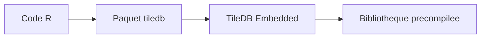

# TileDB-Inc/TileDB-R

> R interface to the TileDB array database, for R users.

## The problem
Storing and reading large multidimensional arrays from R requires an access layer adapted to the TileDB engine.

## What it actually does
Provides the `tiledb` R package on top of TileDB Embedded. If no system installation is found, a precompiled shared library is used at install time. The README does not describe the functions; it points to the package documentation and the TileDB API.

## How it is wired
Simplified diagram based on the sheet, no diagram provided.



## Trying it
```r
install.packages("tiledb")
remotes::install_github("TileDB-Inc/TileDB-R")
library(tiledb)
```

## Cost and gotchas
Free. Requires R and, depending on the case, TileDB Embedded installed; custom path via `--with-tiledb`. This requirement is not in the list of prerequisites.

## What it is not
Not the engine itself, only the R client. The license is not recognized by GitHub, check it before use.

## Alternatives
No alternative named in the README.

## For you
Watch: interesting if your data are dense or sparse arrays and you work in R; without R, go through the TileDB API instead.
