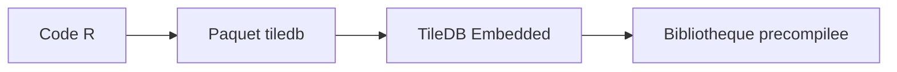

# TileDB-Inc/TileDB-R

> Interface R pour la base de données de tableaux TileDB, pour les utilisateurs de R.

## Le problème
Stocker et lire de gros tableaux multidimensionnels depuis R demande une couche d'accès adaptée au moteur TileDB.

## Ce que ça fait vraiment
Fournit le paquet R `tiledb` au-dessus de TileDB Embedded. Si aucune installation système n'est trouvée, une bibliothèque partagée précompilée est utilisée à l'installation. Le README ne décrit pas les fonctions ; il renvoie à la documentation du paquet et de l'API TileDB.

## Comment c'est branché
Schéma simplifié d'après la fiche, sans diagramme fourni.



## Essayer
```r
install.packages("tiledb")
remotes::install_github("TileDB-Inc/TileDB-R")
library(tiledb)
```

## Coût et pièges
Gratuit. Nécessite R et, selon le cas, TileDB Embedded installé ; chemin personnalisé via `--with-tiledb`. Ce besoin n'entre pas dans la liste des prérequis.

## Ce que ce n'est pas
Pas le moteur lui-même, seulement le client R. La licence n'est pas reconnue par GitHub, à vérifier avant usage.

## Alternatives
Aucune alternative nommée dans le README.

## Pour toi
Surveiller : intéressant si tes données sont des tableaux denses ou épars et que tu travailles sous R ; sans R, passe plutôt par l'API TileDB.

