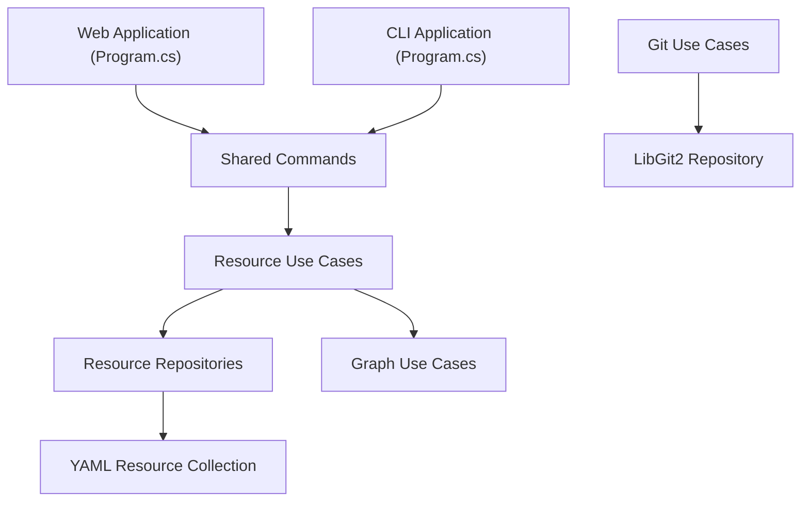

# Timmoth/RackPeek

> Self-hosted CLI and web application to document a homelab in a portable YAML inventory.

## The problem
A homelab inventory (machines, services, links) lives in your head or in scattered spreadsheets, impossible to export to Ansible.

## What it actually does
It keeps hardware, systems, services and connections in a `config.yaml` file. The CLI and the web interface expose the same use cases: adding, searching, reports, Mermaid graph, Ansible and SSH export. An optional Git sync backs up the configuration. There is also an inventory API and an MCP server, and discovery of existing infrastructure is documented.

## How it is wired
Simplified diagram based on the code's diagram.



## Trying it
```bash
docker volume create rackpeek-config
docker run -d \
  --name rackpeek \
  -p 8080:8080 \
  -v rackpeek-config:/app/config \
  aptacode/rackpeek:latest
```

## Cost and gotchas
Free. The mounted directory must be writable by the container's user 1654 (`:Z` suffix with SELinux). The mobile application is in early access.

## What it is not
It is not a monitoring tool: it documents, it does not watch the state of the machines. The YAML is the source of truth, not an enterprise CMDB.

## Alternatives
No alternative named in the README.

## For you
Worth watching: useful for keeping the inventory of an MLOps home lab up to date, but weigh the AGPL license and the single maintainer before any enterprise use.
