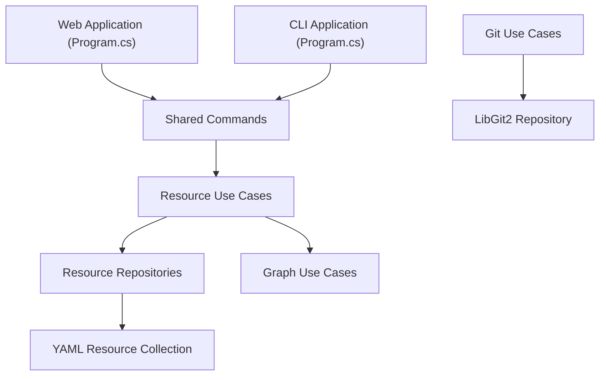

# Timmoth/RackPeek

> CLI et application web auto-hébergées pour documenter un homelab dans un inventaire YAML portable.

## Le problème
L'inventaire d'un homelab (machines, services, liaisons) vit dans la tête ou dans des tableurs dispersés, impossible à exporter vers Ansible.

## Ce que ça fait vraiment
Il garde matériel, systèmes, services et connexions dans un fichier `config.yaml`. La CLI et l'interface web ouvrent les mêmes cas d'usage : ajout, recherche, rapports, graphe Mermaid, export Ansible et SSH. Une synchronisation Git optionnelle sauvegarde la configuration. Il existe aussi une API d'inventaire et un serveur MCP, et la découverte d'infrastructure existante est documentée.

## Comment c'est branché
Schéma simplifié d'après le diagramme du code.



## Essayer
```bash
docker volume create rackpeek-config
docker run -d \
  --name rackpeek \
  -p 8080:8080 \
  -v rackpeek-config:/app/config \
  aptacode/rackpeek:latest
```

## Coût et pièges
Gratuit. Le répertoire monté doit être accessible en écriture par l'utilisateur 1654 du conteneur (suffixe `:Z` avec SELinux). L'application mobile est en accès anticipé.

## Ce que ce n'est pas
Ce n'est pas un outil de supervision : il documente, il ne surveille pas l'état des machines. Le YAML est la source de vérité, pas un CMDB d'entreprise.

## Alternatives
Aucune alternative nommée dans le README.

## Pour toi
À surveiller : utile pour tenir à jour l'inventaire d'un home lab MLOps, mais licence AGPL et mainteneur unique à peser avant un usage en entreprise.

