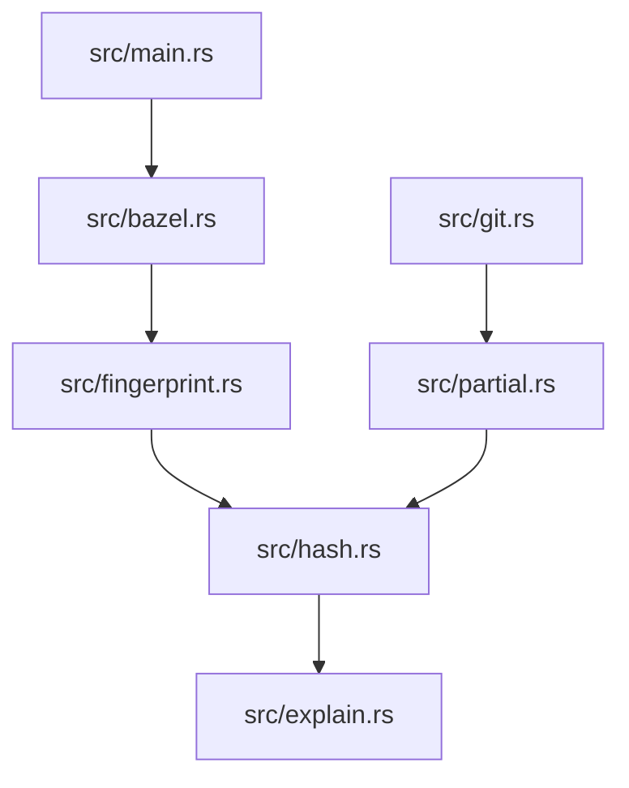

# Tinder/bazel-diff

> Command-line tool that lists the Bazel targets affected between two Git revisions.

## The problem
In a large Bazel monorepo, rerunning all tests on every commit is expensive, and approximations make CI unreliable.

## What it actually does
Computes a fingerprint of each target at two revisions, compares them, and outputs the impacted targets. Adds distances in the graph, an `explain` command (root cause) and an HTTP `serve` service with disk, S3, GCS or Nexus cache. Handles projects with hundreds of thousands of targets.

## How it is wired


## Trying it
```bash
bazel-diff generate-hashes -w /path/to/workspace -b bazel starting_hashes.json
bazel-diff generate-hashes -w /path/to/workspace -b bazel final_hashes.json
bazel-diff get-impacted-targets -w /path/to/workspace -b bazel -sh starting_hashes.json -fh final_hashes.json -o impacted_targets.json
```

## Cost and gotchas
Git and Bazel 8 or later, with a JDK for Bazel; the bazel-diff binary does not need one. The service may depend on S3, GCS or Nexus. License not identified.

## What it is not
Not a build tool: it only tells you what to rebuild. Without Bazel, it is useless.

## Alternatives
- Aspect CLI, `impacted` command (same idea in Starlark).

## For you
Worth watching: interesting if your ML CI runs on a Bazel monorepo; otherwise irrelevant.
