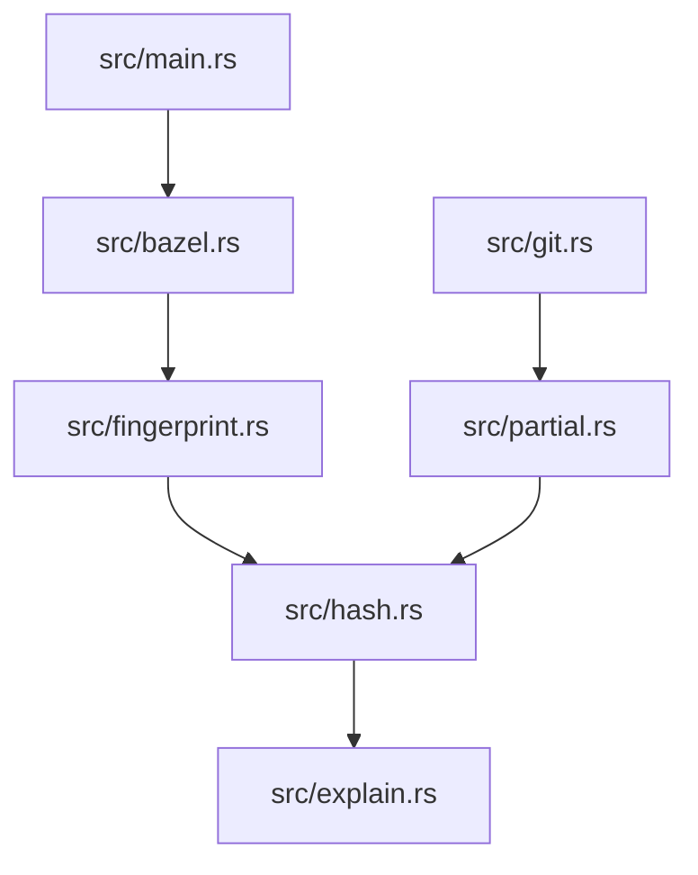

# Tinder/bazel-diff

> Outil en ligne de commande qui liste les cibles Bazel touchées entre deux révisions Git.

## Le problème
Dans un grand monorepo Bazel, relancer tous les tests à chaque commit coûte cher et les approximations rendent la CI peu fiable.

## Ce que ça fait vraiment
Calcule une empreinte de chaque cible à deux révisions, compare, et sort les cibles impactées. Ajoute des distances dans le graphe, une commande `explain` (cause racine) et un service HTTP `serve` avec cache disque, S3, GCS ou Nexus. Tient des projets de centaines de milliers de cibles.

## Comment c'est branché


## Essayer
```bash
bazel-diff generate-hashes -w /path/to/workspace -b bazel starting_hashes.json
bazel-diff generate-hashes -w /path/to/workspace -b bazel final_hashes.json
bazel-diff get-impacted-targets -w /path/to/workspace -b bazel -sh starting_hashes.json -fh final_hashes.json -o impacted_targets.json
```

## Coût et pièges
Git et Bazel 8 ou plus, avec un JDK pour Bazel ; le binaire bazel-diff n'en a pas besoin. Le service peut dépendre de S3, GCS ou Nexus. Licence non identifiée.

## Ce que ce n'est pas
Pas un outil de build : il ne dit que quoi reconstruire. Sans Bazel, il ne sert à rien.

## Alternatives
- Aspect CLI, commande `impacted` (même idée en Starlark).

## Pour toi
À surveiller : intéressant si ta CI ML tourne sur un monorepo Bazel ; sinon sans objet.

