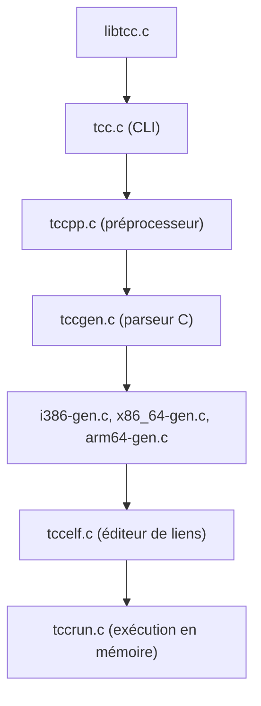

# TinyCC/tinycc

> Tiny, fast C compiler that compiles and runs C directly, usable as a script.

## The problem
Compiling C with GCC is slow for small programs and makes C unusable as a scripting language.

## What it actually does
Compiles in a single pass to i386, x86_64, ARM, AArch64 or riscv64, about ten times faster than gcc -O0 according to the README. It includes a preprocessor, assembler and linker, can write ELF, PE and Mach-O, and runs C in memory (-run). An optional memory bounds checker instruments the code; libtcc allows embedding.

## How it is wired


## Trying it
```bash
./configure
make
make test
make install
```

## Cost and gotchas
Free. On BSD, use gmake. Windows: read tcc-win32.txt. makeinfo is needed for the documentation. LGPL.

## What it is not
Not an optimizing compiler: it aims at compilation speed. Full C99 conformance is in progress, not achieved.

## Alternatives
No alternative cited in the README (gcc is only mentioned as a point of comparison).

## For you
Ignore: a useful curiosity for throwaway C, but unrelated to a data / AI workflow.
