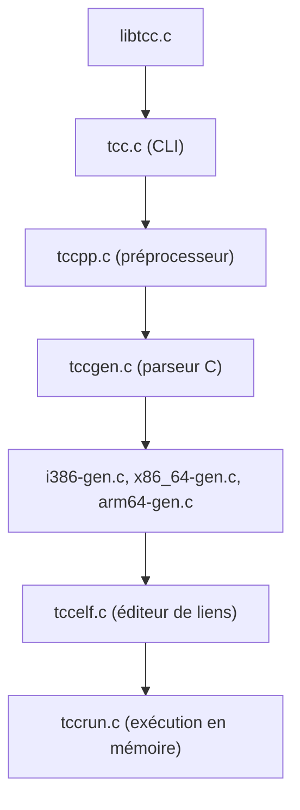

# TinyCC/tinycc

> Compilateur C minuscule et rapide, qui compile et exécute du C directement, utilisable comme script.

## Le problème
Compiler du C avec GCC est lent pour de petits programmes et rend impossible le C comme langage de script.

## Ce que ça fait vraiment
Compile en une passe vers i386, x86_64, ARM, AArch64 ou riscv64, environ dix fois plus vite que gcc -O0 d'après le README. Il inclut préprocesseur, assembleur et éditeur de liens, sait écrire en ELF, PE et Mach-O, et exécute du C en mémoire (-run). Un contrôleur de limites mémoire optionnel instrumente le code ; libtcc permet l'embarquement.

## Comment c'est branché


## Essayer
```bash
./configure
make
make test
make install
```

## Coût et pièges
Gratuit. Sur BSD, utiliser gmake. Windows : lire tcc-win32.txt. makeinfo nécessaire pour la documentation. LGPL.

## Ce que ce n'est pas
Pas un compilateur optimisant : il vise la vitesse de compilation. La conformité complète à C99 est en cours, pas acquise.

## Alternatives
Aucune alternative citée dans le README (gcc est seulement cité comme point de comparaison).

## Pour toi
Ignorer : curiosité utile pour du C jetable, mais sans rapport avec un flux data / IA.

