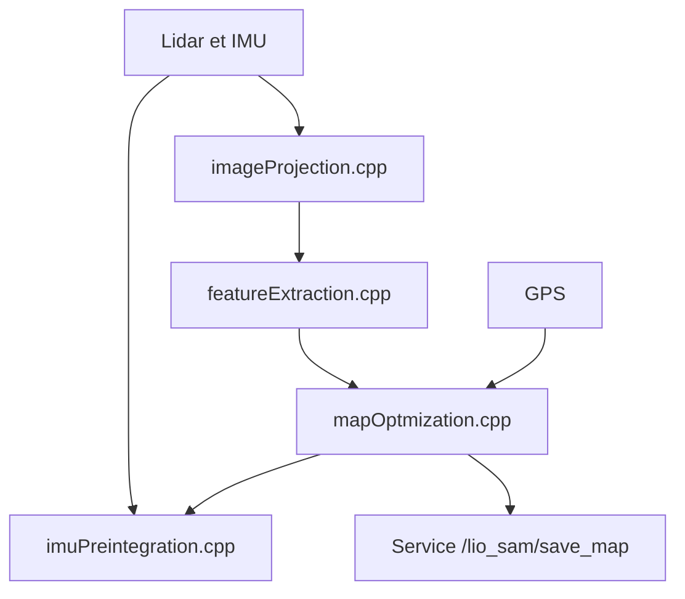

# TixiaoShan/LIO-SAM

> ROS package for real-time lidar-inertial odometry and mapping, for robots equipped with lidar and IMU.

## The problem
Estimating a robot's pose and building a map from a lidar alone drifts, especially during fast motion.

## What it actually does
LIO-SAM corrects point clouds with IMU measurements (deskew), extracts features, then optimizes two factor graphs (GTSAM): one for the map (lidar, GPS, loop closure), the other for odometry at IMU frequency, periodically reset. It can save the map as PCD.

## How it is wired


## Trying it
```bash
cd ~/catkin_ws/src
git clone https://github.com/TixiaoShan/LIO-SAM.git
cd ..
catkin_make
roslaunch lio_sam run.launch
rosbag play your-bag.bag -r 3
```

## Cost and gotchas
Free (BSD-3). Requires ROS1 (Kinetic or Melodic), GTSAM, a mechanical lidar with per-point time and ring, and a 9-axis IMU of at least 200 Hz, with extrinsics to tune. ROS2 version on a separate branch. Last push February 2025; a known bug in `imuPreintegration`.

## What it is not
Not a tool ready for every sensor: solid-state lidar is little tested, 6-axis IMU is not supported. Not AI vision software.

## Alternatives
- liorf: variant that supports 6-axis IMU and more lidars.
- LIO-SAM with Scan Context: more advanced loop closure.

## For you
Watch if you do robotics or 3D perception: a SLAM reference, but ROS1 and a barely active repository.
