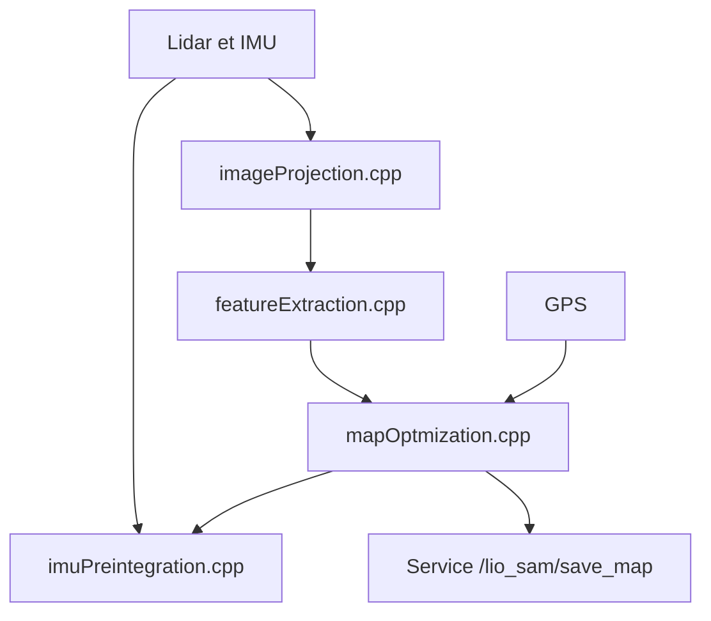

# TixiaoShan/LIO-SAM

> Paquet ROS d'odométrie lidar-inertielle temps réel et de cartographie, pour robots équipés de lidar et d'IMU.

## Le problème
Estimer la pose d'un robot et construire une carte à partir d'un lidar seul dérive, surtout lors de mouvements rapides.

## Ce que ça fait vraiment
LIO-SAM corrige les nuages de points avec les mesures IMU (déskew), extrait des caractéristiques, puis optimise deux graphes de facteurs (GTSAM) : l'un pour la carte (lidar, GPS, fermeture de boucle), l'autre pour l'odométrie à fréquence IMU, remise à zéro périodiquement. Il sait enregistrer la carte en PCD.

## Comment c'est branché


## Essayer
```bash
cd ~/catkin_ws/src
git clone https://github.com/TixiaoShan/LIO-SAM.git
cd ..
catkin_make
roslaunch lio_sam run.launch
rosbag play your-bag.bag -r 3
```

## Coût et pièges
Gratuit (BSD-3). Il faut ROS1 (Kinetic ou Melodic), GTSAM, un lidar mécanique avec temps et anneau par point et une IMU 9 axes d'au moins 200 Hz, avec extrinsèques à régler. Version ROS2 sur une branche à part. Dernier push février 2025 ; un bug connu dans `imuPreintegration`.

## Ce que ce n'est pas
Pas un outil prêt pour tous les capteurs : lidar à semi-conducteurs peu testé, IMU 6 axes non gérée. Pas un logiciel de vision par IA.

## Alternatives
- liorf : variante qui prend en charge l'IMU 6 axes et plus de lidars.
- LIO-SAM with Scan Context : fermeture de boucle plus avancée.

## Pour toi
À surveiller si tu fais de la robotique ou de la perception 3D : référence de SLAM, mais ROS1 et dépôt peu actif.

