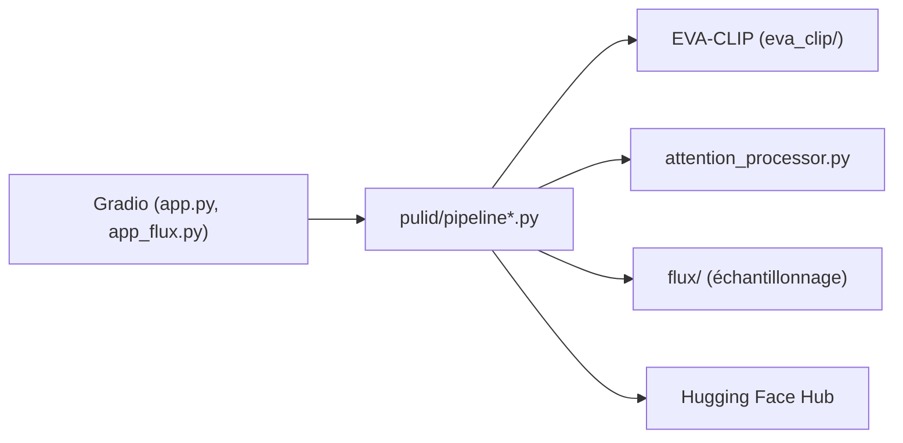

# ToTheBeginning/PuLID

> Identity customization method for SDXL and FLUX that preserves a face from a photo.

## The problem
Generating images of a specific person without degrading style or face fidelity, and without lengthy tuning.

## What it actually does
Encodes a reference image (EVA-CLIP), aligns the features through contrastive learning and injects them into the diffusion model via attention processors. Versions PuLID-v1 and v1.1 (SDXL) and PuLID-FLUX v0.9.0/v0.9.1. Local and online Gradio demos.

## How it is wired


## Trying it
```bash
git clone https://github.com/ToTheBeginning/PuLID.git
cd PuLID
conda create --name pulid python=3.10
conda activate pulid
pip install -r requirements.txt
python app.py
```

## Cost and gotchas
GPU required; PyTorch ≥ 2.4.1 and `requirements_fp8.txt` for FLUX on consumer GPUs. Last push in July 2025 (more than a year ago).

## What it is not
Face customization exposes to identity impersonation: the README reminds users of responsible use and disclaims any liability. The authors announce DreamO as the successor.

## Alternatives
- DreamO: unified framework (identity, IP, try-on, style) promoted by the authors.
- PuLID_ComfyUI (cubiq): native ComfyUI implementation.

## For you
Worth watching: useful to understand identity customization, but the authors are already steering toward DreamO.
