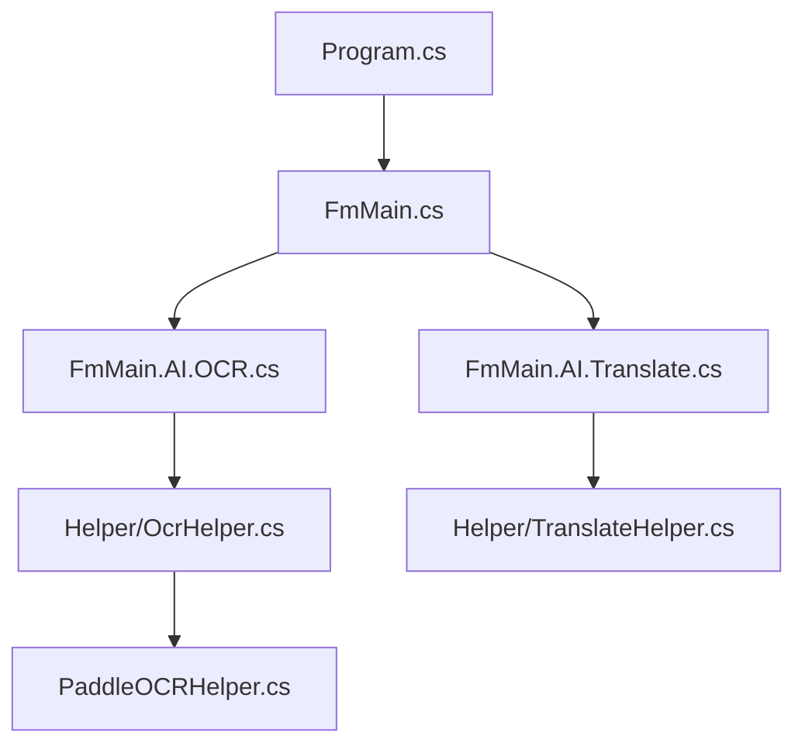

# Topkill/tianruoocr

> Windows application for text recognition and translation from screen captures, with local or online engines.

## The problem
Quickly extract and translate text shown on screen or in an image.

## What it actually does
Recognition via a hotkey (F4), silent or with a window, translation of a selection (F9), of a capture, of the clipboard, or of typed input. Offline OCR engines (PaddleOCR, PaddleOCR2, RapidOCR) or online ones (Baidu, Tencent, an AI interface with a prompt). Translation through Bing, Google (a suitable network is required) or an OpenAI-compatible API. The interface is in Chinese.

## How it is wired


## Trying it
```bash
# Aucune commande documentée : lancer l'application Windows ; F4 pour reconnaître, F9 pour traduire.
```

## Cost and gotchas
Windows (tested on Windows 10). The online interfaces require keys with free quotas and then billing: the README advises setting up balance alerts. The README is in Chinese, and settings are only saved when the page is closed.

## What it is not
Not an OCR library reusable in a pipeline: it is a desktop application.

## Alternatives
AnyListen/tianruoocr: the original project from which this one is derived.

## For you
Ignore: an interactive Windows application, poorly suited to automated processing; for OCR in a pipeline, libraries are a better fit.
