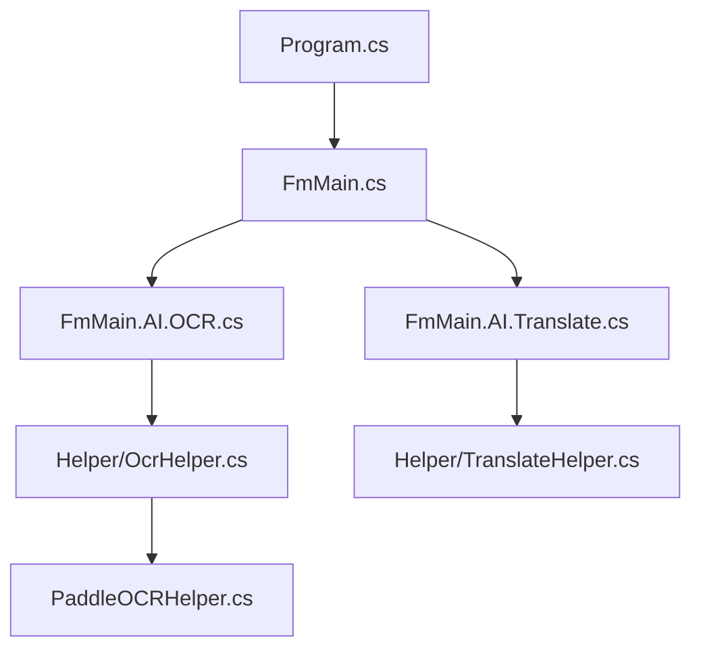

# Topkill/tianruoocr

> Application Windows de reconnaissance de texte et de traduction par capture d'écran, moteurs locaux ou en ligne.

## Le problème
Extraire et traduire rapidement du texte présent à l'écran ou dans une image.

## Ce que ça fait vraiment
Reconnaissance par raccourci (F4), silencieuse ou avec fenêtre, traduction de sélection (F9), de capture, du presse-papiers ou saisie. Moteurs OCR hors ligne (PaddleOCR, PaddleOCR2, RapidOCR) ou en ligne (Baidu, Tencent, interface IA à invite). Traduction par Bing, Google (réseau adapté requis) ou API compatible OpenAI. Interface en chinois.

## Comment c'est branché


## Essayer
```bash
# Aucune commande documentée : lancer l'application Windows ; F4 pour reconnaître, F9 pour traduire.
```

## Coût et pièges
Windows (testé sous Windows 10). Les interfaces en ligne demandent des clés avec quotas gratuits puis facturation : le README conseille des alertes de solde. Le README est en chinois, les réglages ne s'enregistrent qu'à la fermeture de la page.

## Ce que ce n'est pas
Pas une bibliothèque OCR réutilisable en pipeline : une application de bureau.

## Alternatives
AnyListen/tianruoocr : projet d'origine dont celui-ci est dérivé.

## Pour toi
Ignorer : application Windows interactive, peu adaptée à un traitement automatisé ; pour de l'OCR en pipeline, des bibliothèques sont plus adaptées.

