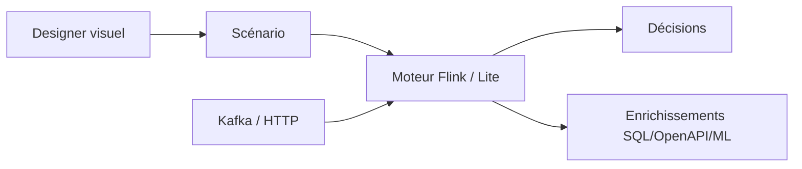

# TouK/nussknacker

> Visual low-code tool to build and run real-time decision algorithms.

## The problem
Decision rules (fraud, offer, scoring) are coded by developers, which slows down iterations.

## What it actually does
A "scenario" editor assembles components (routing, filtering, windowed aggregations, SQL or OpenAPI enrichments, ML models) with the SpEL expression language. Modes: streaming (Kafka) and request-response (HTTP/OpenAPI); Flink engine or lightweight runtime. Built-in monitoring, testing and debugging. Batch is under development.

## How it is wired


## Trying it
```bash
curl -o- https://raw.githubusercontent.com/TouK/nussknacker-quickstart/main/download-and-start.sh | bash
```

## Cost and gotchas
Free (Apache 2.0). Scala 2.13; only one supported Flink version; Kafka, Flink, Kubernetes for high throughput. A privacy policy must be accepted.

## What it is not
Not an ML model platform: it calls models as enrichments.

## Alternatives
No alternative named in the README.

## For you
Worth watching: useful for deploying models with pre- and post-processing in streams; the Kafka/Flink stack is heavy to operate.
