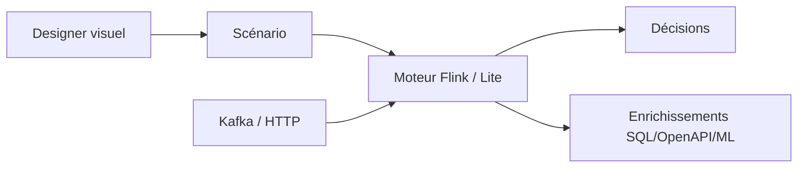

# TouK/nussknacker

> Outil low-code visuel pour construire et exécuter des algorithmes de décision en temps réel.

## Le problème
Les règles de décision (fraude, offre, scoring) sont codées par des développeurs, ce qui ralentit les itérations.

## Ce que ça fait vraiment
Un éditeur de « scénarios » assemble des composants (routage, filtrage, agrégations en fenêtres, enrichissements SQL ou OpenAPI, modèles ML) avec le langage d'expression SpEL. Modes : flux (Kafka) et requête-réponse (HTTP/OpenAPI) ; moteur Flink ou runtime léger. Supervision intégrée, tests et débogage. Le batch est en développement.

## Comment c'est branché


## Essayer
```bash
curl -o- https://raw.githubusercontent.com/TouK/nussknacker-quickstart/main/download-and-start.sh | bash
```

## Coût et pièges
Gratuit (Apache 2.0). Scala 2.13 ; une seule version de Flink prise en charge ; Kafka, Flink, Kubernetes pour le haut débit. Politique de confidentialité à accepter.

## Ce que ce n'est pas
Pas une plateforme de modèles ML : il les appelle comme enrichissements.

## Alternatives
Aucune alternative nommée dans le README.

## Pour toi
À surveiller : utile pour déployer des modèles avec pré et post-traitement en flux ; la pile Kafka/Flink est lourde à opérer.

