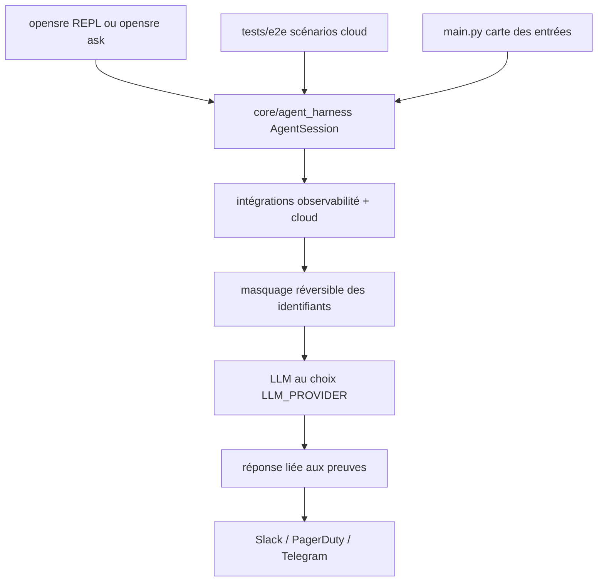

# Tracer-Cloud/opensre

> Open framework of SRE agents that correlate logs, metrics and traces to diagnose an incident.

## The problem
When production breaks, the clues are scattered across logs, metrics, traces, runbooks and Slack threads.
Unlike code, incident response has no equivalent of SWE-bench: no training data, no clear feedback.

## What it actually does
On a question or an alert: retrieves the correlated context, masks sensitive identifiers before any external call, tests hypotheses in a tool loop, answers with linked evidence, proposes next steps, posts a summary to Slack, PagerDuty or Telegram.
Three entry points: interactive REPL with slash commands (`/status`, `/cost`, `/sessions`, `/resume`, `/integrations`, `/agents`), non-interactive CLI (`opensre ask`), and Python API (`AgentSession`).
Announced connection to more than 60 tools: observability (Grafana, Datadog, CloudWatch, Sentry, Splunk…), infrastructure, databases, data platforms, incident management, MCP and ACP.
Model of your choice: Anthropic, OpenAI, Codex, Ollama, Gemini, OpenRouter, TrustedRouter, NVIDIA NIM, Bedrock.

## How it is wired


## Trying it
```bash
curl -fsSL https://install.opensre.com | bash
opensre
opensre ask "why is checkout-api slow?"
opensre setup --dev
opensre integrations setup
opensre fleet scan
opensre update
opensre uninstall
export OPENSRE_NO_TELEMETRY=1
```

## Cost and gotchas
Public alpha announced as not yet stable, APIs and integrations subject to change.
The first launch requires an account and enables the hosted model; the shell only opens for an active account. Product analytics and Sentry are opt-out. Self-hosted, you need `LLM_PROVIDER`, the matching key, and `DATABASE_URI`/`REDIS_URI` for persistence.

## What it is not
Not yet a benchmark: the reinforcement learning environment for incident response is the stated goal, not the current state.
Not usable without authentication: the account gates the start of the REPL.
Not an automatic remediation tool by default — running corrective actions is presented as optional.

## Alternatives
No alternative named; SWE-bench is cited as an analogy, not as a competitor.

## For you
Worth following for the masking and linked-evidence parts; the alpha and the mandatory account rule out serious use right now.
