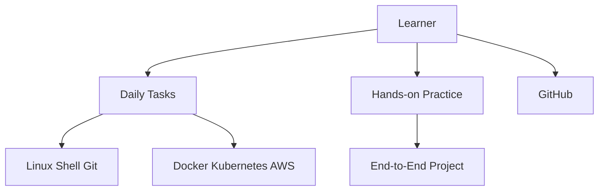

# TrainWithShubham/90DaysOfDevOps

> Daily 90-day path to learn DevOps hands-on, for beginners.

## The problem
Learning DevOps from videos alone gives neither discipline nor proof of work.

## What it actually does
One folder per day with a task, aligned with live courses. Covers Linux, shell, networking, Git, Docker, AWS, CI/CD, Kubernetes, Terraform, Ansible, observability, plus a final project. You fork the repo and push your work.

## How it is wired

## Trying it
No commands: the README describes five manual steps.
1. Fork the repo.
2. Clone your fork.
3. Open the day's `day-XX` folder.
4. Do the task.
5. Commit and push.

## Cost and gotchas
Free. The AWS tasks may incur charges on your cloud account. The README gives no figures.

## What it is not
Not software nor a complete course: the content of the days was not inspected. Not MLOps-oriented in particular. The tree mixes material from 2023 to 2026.

## Alternatives
No alternative named in the README.

## For you
Worth watching: useful for filling infrastructure basics before MLOps, of no interest if you already have them.
