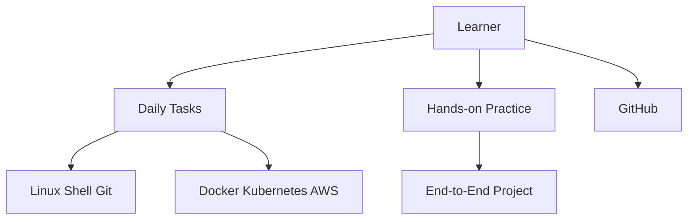

# TrainWithShubham/90DaysOfDevOps

> Parcours quotidien de 90 jours pour apprendre le DevOps par la pratique, pour débutants.

## Le problème
Apprendre le DevOps par vidéos seules ne donne ni discipline ni preuve de travail.

## Ce que ça fait vraiment
Un dossier par jour avec une tâche, aligné sur des cours en direct. Couvre Linux, shell, réseau, Git, Docker, AWS, CI/CD, Kubernetes, Terraform, Ansible, observabilité, plus un projet final. On forke le dépôt et on pousse son travail.

## Comment c'est branché

## Essayer
Aucune commande : le README décrit cinq étapes manuelles.
1. Forker le dépôt.
2. Cloner son fork.
3. Ouvrir le dossier `day-XX` du jour.
4. Faire la tâche.
5. Commit et push.

## Coût et pièges
Gratuit. Les tâches AWS peuvent engager des frais sur ton compte cloud. Le README ne chiffre rien.

## Ce que ce n'est pas
Pas un logiciel ni un cours complet : le contenu des jours n'a pas été inspecté. Pas orienté MLOps en particulier. L'arbre mêle des matériaux de 2023 à 2026.

## Alternatives
Aucune alternative nommée dans le README.

## Pour toi
À surveiller : utile pour combler des bases d'infrastructure avant du MLOps, sans intérêt si tu les as déjà.

