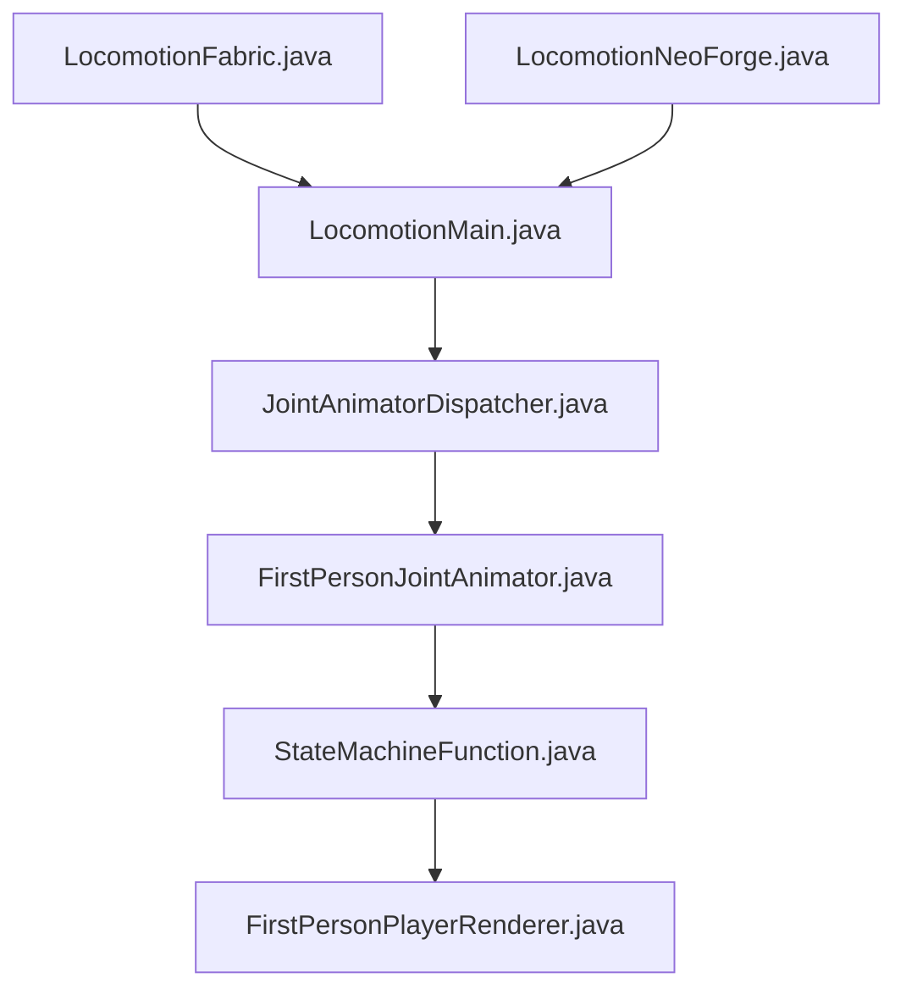

# Trainguy9512/locomotion

> Minecraft Java mod that animates the player and items with a system inspired by Unreal's Animation Blueprints.

## The problem
Vanilla Minecraft animations are rigid, with no state and no pose blending.

## What it actually does
A real-time animation engine with state machines, blend spaces and montage tracks, a PyQt exporter for Maya and in-game settings. Only first-person animations are in progress; Fabric and NeoForge are supported, through rendering mixins.

## How it is wired

## Trying it
No documented command. The README points to a test version (playtest) to download and to a personal build.

## Cost and gotchas
Free, but Java and a Gradle build are required (not listed in the prerequisites). "All rights reserved" license: no republishing or modpack inclusion without written permission.

## What it is not
Not a stable version: the README announces missing animations and debug visuals. Not available on Modrinth or CurseForge.

## Alternatives
No alternative cited in the README.

## For you
Ignore: game mod, closed license and work-in-progress project, with no link to data or AI work.
