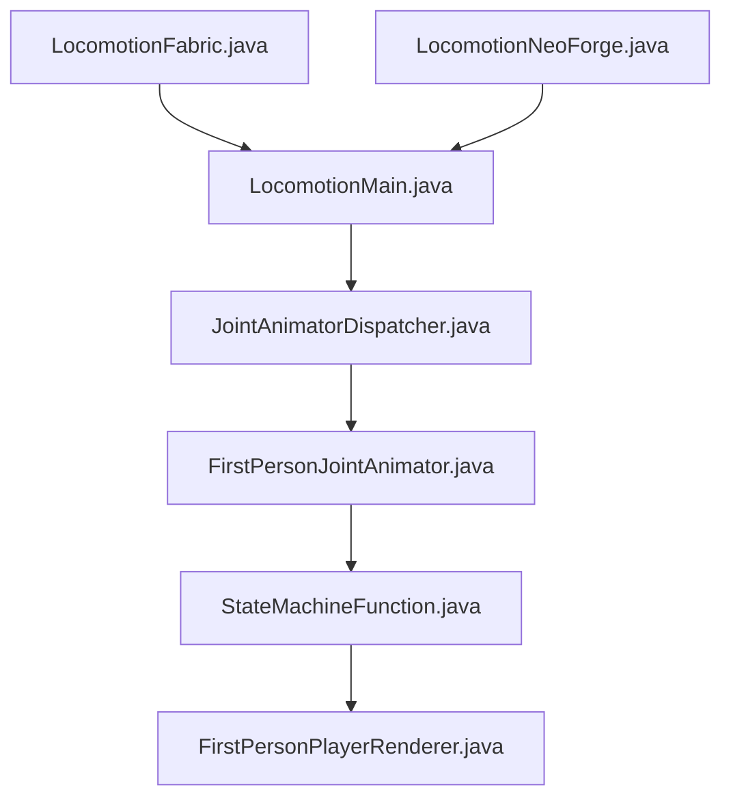

# Trainguy9512/locomotion

> Mod Minecraft Java qui anime joueur et objets avec un système inspiré des Animation Blueprints d'Unreal.

## Le problème
Les animations vanilla de Minecraft sont figées et sans état ni mélange de poses.

## Ce que ça fait vraiment
Un moteur d'animation en temps réel avec machines à états, espaces de mélange et pistes de montage, un exporteur PyQt pour Maya et des réglages en jeu. Seules les animations à la première personne sont en cours ; Fabric et NeoForge sont pris en charge, via des mixins de rendu.

## Comment c'est branché

## Essayer
Aucune commande documentée. Le README renvoie vers une version de test (playtest) à télécharger et vers une compilation personnelle.

## Coût et pièges
Gratuit, mais Java et un build Gradle sont nécessaires (non listés dans les prérequis). Licence « tous droits réservés » : pas de republication ni de modpack sans accord écrit.

## Ce que ce n'est pas
Pas une version stable : le README annonce des animations manquantes et des visuels de débogage. Pas disponible sur Modrinth ni CurseForge.

## Alternatives
Aucune alternative citée dans le README.

## Pour toi
Ignorer : mod de jeu, licence fermée et projet en chantier, sans lien avec un travail data ou IA.

