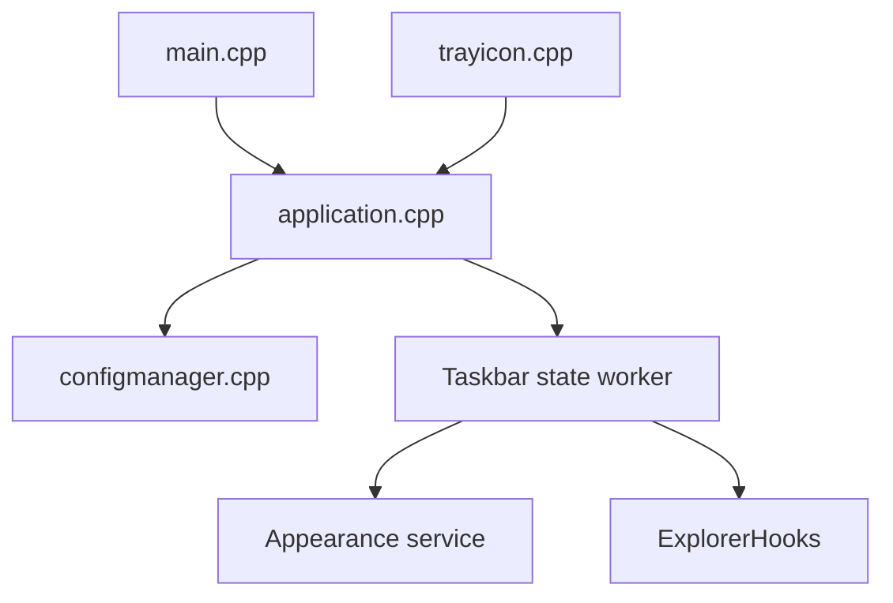

# TranslucentTB/TranslucentTB

> Small Windows utility that makes the taskbar translucent, to customize your desktop.

## The problem
The Windows taskbar has no native option for transparency, blur or color.

## What it actually does
It applies a state to the taskbar (opaque, clear, blur, acrylic) with a color picker and alpha. Dynamic modes change the appearance depending on the visible or maximized window, the Start menu, search or task view. The application works through hooks in Explorer.

## How it is wired
Diagram based on the supplied one, reduced.

## Trying it
No command: install through the Microsoft Store, or `TranslucentTB.appinstaller` / `TranslucentTB.zip` (Windows 11 only) from the releases. For automatic startup, the README provides registry keys to apply.

## Cost and gotchas
Free (GPL-3.0). Some antivirus programs flag it by mistake, according to the README. The portable version only works on Windows 11.

## What it is not
Not a complete Windows theme. Only works on Windows 10 and 11, with modes depending on the version.

## Alternatives
No alternative named (RoundedTB and ExplorerPatcher are cited as compatible, not as alternatives).

## For you
Ignore: a Windows desktop customization utility, unrelated to data, AI or MLOps.
