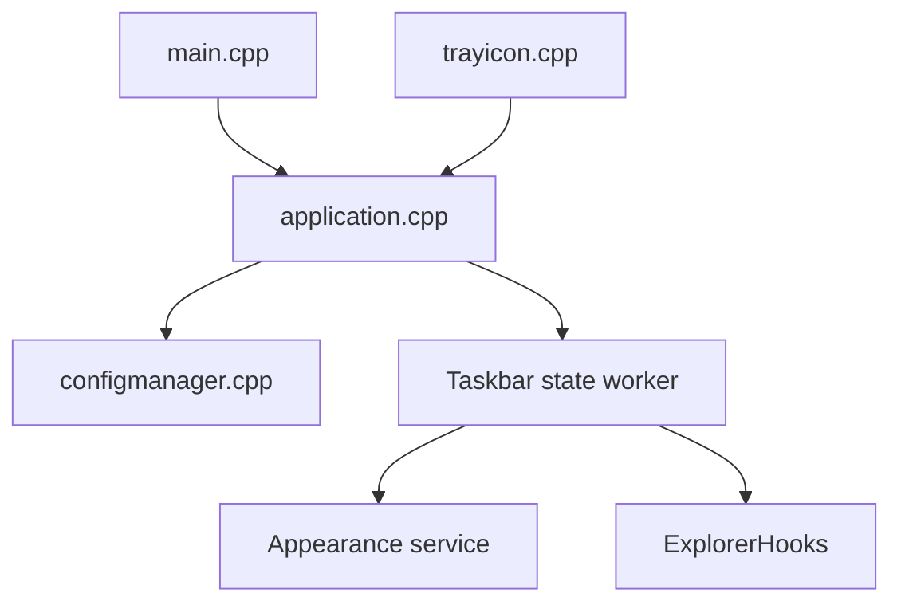

# TranslucentTB/TranslucentTB

> Petit utilitaire Windows qui rend la barre des tâches translucide, pour personnaliser son bureau.

## Le problème
La barre des tâches Windows n'a pas d'option native pour la transparence, le flou ou la couleur.

## Ce que ça fait vraiment
Il applique à la barre des tâches un état (opaque, clair, flou, acrylique) avec sélecteur de couleur et alpha. Des modes dynamiques changent l'apparence selon la fenêtre visible ou maximisée, le menu Démarrer, la recherche ou la vue des tâches. L'application passe par des hooks dans Explorer.

## Comment c'est branché
Schéma d'après le diagramme fourni, réduit.

## Essayer
Aucune commande : installation par le Microsoft Store, ou `TranslucentTB.appinstaller` / `TranslucentTB.zip` (Windows 11 seulement) depuis les releases. Pour le démarrage automatique, le README fournit des clés de registre à appliquer.

## Coût et pièges
Gratuit (GPL-3.0). Certains antivirus le signalent à tort, selon le README. La version portable ne fonctionne que sous Windows 11.

## Ce que ce n'est pas
Pas un thème Windows complet. Ne fonctionne que sous Windows 10 et 11, avec des modes dépendant de la version.

## Alternatives
Aucune alternative nommée (RoundedTB et ExplorerPatcher sont cités comme compatibles, pas comme alternatives).

## Pour toi
À ignorer : utilitaire de personnalisation du bureau Windows, sans lien avec data, IA ou MLOps.

