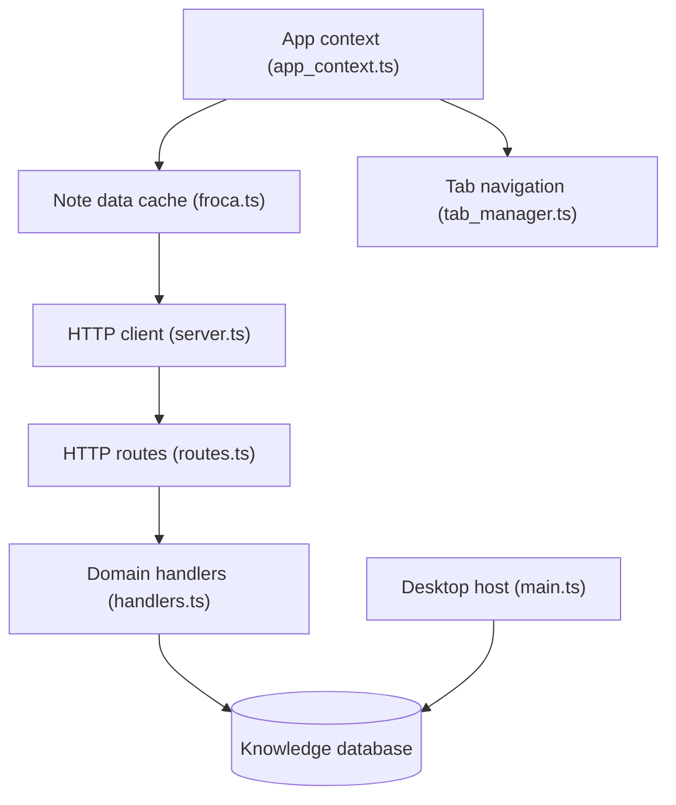

# TriliumNext/Trilium

> Free, cross-platform hierarchical note-taking app, for building large personal knowledge bases.

## The problem
Personal notes become unreadable when they pile up flat. You need a tree structure, search and versioning without depending on a SaaS.

## What it actually does
Notes arranged in a tree (a note can appear in several places), WYSIWYG editor, code notes, Excalidraw canvas, mind maps, geographic maps. Per-note encryption, synchronization with a self-hosted server, REST API and scripts. Evernote and Markdown import. The README claims it holds up beyond 100,000 notes.

## How it is wired


## Trying it
```bash
git clone https://github.com/TriliumNext/Trilium.git
cd Trilium
pnpm install
pnpm run server:start
```
For normal use: download the binary of the latest release, unpack it, run `trilium`. Docker: see the server installation docs.

## Cost and gotchas
Free. Versions after v0.90.4 are no longer sync-compatible with zadam/trilium v0.63.7. Third-party mobile apps require the same sync version as the server.

## What it is not
Not a linked-database tool like Notion. No official mobile app: mobile goes through the browser or third-party clients. AGPL license: restrictive if you embed it in a service.

## Alternatives
- zadam/Trilium: the original repo, to keep only if you want to stay on v0.63.x.
- The TriliumDroid, Pocket Trilium and Trinote clients cited in the README cover mobile.

## For you
Useful as a self-hosted personal knowledge base with API and scripts, but unrelated to data/AI work: worth watching rather than adopting by default.
