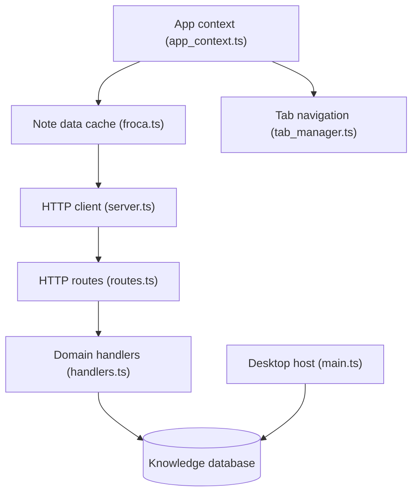

# TriliumNext/Trilium

> Application de notes hiérarchiques libre et multiplateforme, pour bâtir de grandes bases de connaissances personnelles.

## Le problème
Les notes personnelles deviennent illisibles quand elles s'accumulent à plat. Il faut une arborescence, de la recherche et du versionnement sans dépendre d'un SaaS.

## Ce que ça fait vraiment
Notes rangées en arbre (une note peut apparaître à plusieurs endroits), éditeur WYSIWYG, notes de code, canvas Excalidraw, cartes mentales, cartes géographiques. Chiffrement par note, synchronisation avec un serveur auto-hébergé, API REST et scripts. Import Evernote et Markdown. Le README annonce une tenue au-delà de 100 000 notes.

## Comment c'est branché


## Essayer
```bash
git clone https://github.com/TriliumNext/Trilium.git
cd Trilium
pnpm install
pnpm run server:start
```
Pour un usage normal : télécharger le binaire de la dernière release, le décompresser, lancer `trilium`. Docker : voir la doc d'installation serveur.

## Coût et pièges
Gratuit. Les versions après v0.90.4 ne sont plus compatibles en synchro avec zadam/trilium v0.63.7. Les apps mobiles tierces exigent la même version de synchro que le serveur.

## Ce que ce n'est pas
Pas un outil de bases liées façon Notion. Pas d'app mobile officielle : le mobile passe par le navigateur ou des clients tiers. Licence AGPL : contraignante si tu l'intègres dans un service.

## Alternatives
- zadam/Trilium : dépôt d'origine, à garder seulement pour rester sur v0.63.x.
- Les clients TriliumDroid, Pocket Trilium et Trinote cités au README couvrent le mobile.

## Pour toi
Utile comme base de connaissances personnelle auto-hébergée avec API et scripts, mais sans lien avec le travail data/IA : à surveiller plutôt qu'à adopter par défaut.

