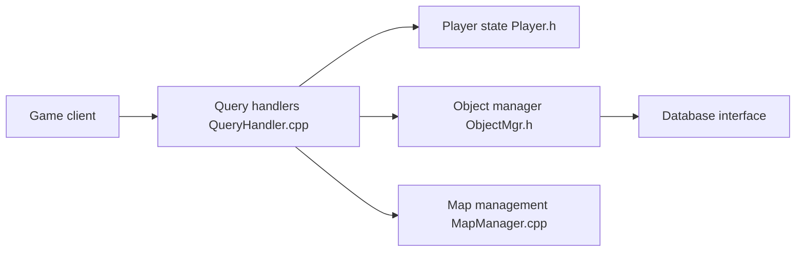

# TrinityCore/TrinityCore

> C++ MMORPG server framework, derived from MaNGOS, for hosting a compatible game server.

## The problem
Running your own server for an MMORPG requires an authentication engine, a world engine and game data.

## What it actually does
C++ server: opcode handlers that answer client requests, player state, objects and loot, combat threat, quests, maps, collisions and navigation. It also includes tools to extract client data (CASC) and database access.

## How it is wired


## Trying it
```bash
# Installation décrite dans le wiki externe ; aucune commande dans le README.
```

## Cost and gotchas
Free; compilation and database setup are done following the wiki. The game client data must be supplied (not detailed).

## What it is not
Not a game: a server engine. GPL-2.0, copyleft. The 1,511 open issues indicate a large, active workload.

## Alternatives
No alternative named, other than MaNGOS, from which it derives.

## For you
Ignore: a game server unrelated to data, AI or MLOps.
