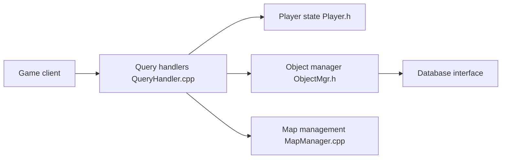

# TrinityCore/TrinityCore

> Framework serveur MMORPG en C++, dérivé de MaNGOS, pour héberger un serveur de jeu compatible.

## Le problème
Faire tourner son propre serveur pour un MMORPG demande un moteur d'authentification, de monde et de données de jeu.

## Ce que ça fait vraiment
Serveur C++ : gestionnaires d'opcodes qui répondent aux requêtes du client, état des joueurs, objets et butin, menaces de combat, quêtes, cartes, collisions et navigation. Inclut aussi des outils d'extraction de données du client (CASC) et un accès base de données.

## Comment c'est branché


## Essayer
```bash
# Installation décrite dans le wiki externe ; aucune commande dans le README.
```

## Coût et pièges
Gratuit ; compilation et base de données à monter selon le wiki. Les données du client du jeu sont à fournir (non détaillé).

## Ce que ce n'est pas
Pas un jeu : un moteur serveur. GPL-2.0, copyleft. Les 1 511 issues ouvertes indiquent un chantier actif et vaste.

## Alternatives
Aucune alternative nommée, hormis MaNGOS dont il dérive.

## Pour toi
À ignorer : serveur de jeu sans rapport avec la data, l'IA ou le MLOps.

