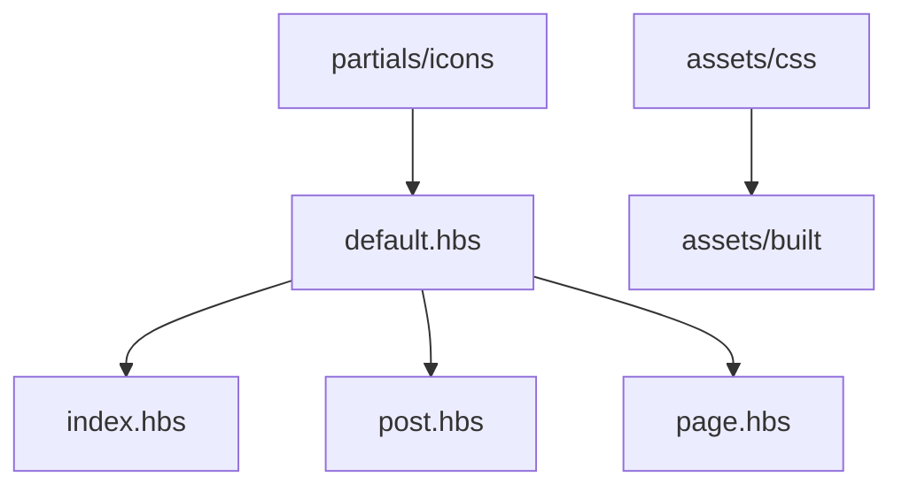

# TryGhost/Casper

> Classic Ghost theme, formerly the default, for editorial sites.

## The problem
A Ghost blog needs a readable, documented starter theme.

## What it actually does
Handlebars theme (`default.hbs`, `index.hbs`, `post.hbs`, `page.hbs`, `tag.hbs`, `author.hbs`) with one-off templates per slug, CSS compiled via Gulp/PostCSS (Autoprefixer, Color Mod), SVG icons as partials, external translations. The current default theme is Source.

## How it is wired


## Trying it
```bash
pnpm install
pnpm dev
pnpm zip
```

## Cost and gotchas
Free; Node, pnpm and Gulp are required for development. A release is published in two steps: `pnpm version minor` then `pnpm ship`.

## What it is not
Not Ghost's current default theme (that is Source), nor a blog engine.

## Alternatives
- Source: Ghost's current default theme.

## For you
Ignore: a blog theme, unless you publish on Ghost.
