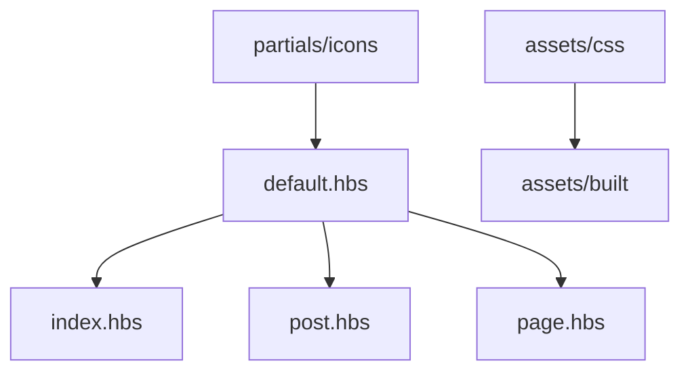

# TryGhost/Casper

> Thème classique de Ghost, anciennement par défaut, pour sites éditoriaux.

## Le problème
Un blog Ghost a besoin d'un thème de départ lisible et documenté.

## Ce que ça fait vraiment
Thème Handlebars (`default.hbs`, `index.hbs`, `post.hbs`, `page.hbs`, `tag.hbs`, `author.hbs`) avec gabarits ponctuels par slug, CSS compilé via Gulp/PostCSS (Autoprefixer, Color Mod), icônes SVG en partials, traductions externes. Le thème par défaut actuel est Source.

## Comment c'est branché


## Essayer
```bash
pnpm install
pnpm dev
pnpm zip
```

## Coût et pièges
Gratuit ; Node, pnpm et Gulp requis pour le développement. Une version se publie en deux temps : `pnpm version minor` puis `pnpm ship`.

## Ce que ce n'est pas
Pas le thème par défaut actuel de Ghost (c'est Source), ni un moteur de blog.

## Alternatives
- Source : thème par défaut actuel de Ghost.

## Pour toi
À ignorer : thème de blog, sauf si tu publies sur Ghost.

