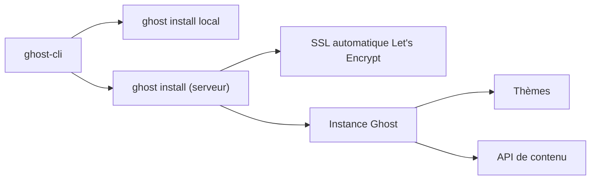

# TryGhost/Ghost

> Publishing and newsletter platform, self-hostable or as a managed service.

## The problem
Publishing an editorial site requires hosting, CDN, backups, security and maintenance — time taken away from writing.

## What it actually does
The README provided focuses on installation. A CLI, `ghost-cli`, installs an instance locally (`ghost install local`, in under a minute) or on a server (`ghost install`, with automatic SSL configuration via Let's Encrypt). The official documentation covers the recommended hosting stack, upgrading, theme development and the API. A changelog newsletter and a community forum keep you up to date.

## How it is wired


## Trying it
```bash
npm install ghost-cli -g
ghost install local
ghost install
```

## Cost and gotchas
Self-hosting is free but leaves CDN, backups, security and maintenance on your hands. The managed Ghost(Pro) offering is paid; the README states that 100% of its revenue goes to the Ghost Foundation and funds the project. 24/7 email support is reserved for Ghost(Pro) customers.

## What it is not
The README documents neither system prerequisites, nor the database, nor supported Node versions: everything is deferred to the docs. It is not a static site generator.

## Alternatives
No alternative named in the README.

## For you
Worth watching: outside your data/AI core business, but the right choice if you need to publish a self-hosted technical newsletter.
