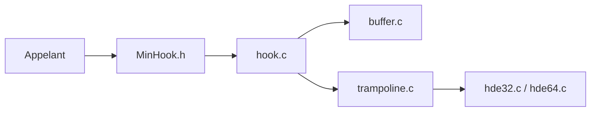

# TsudaKageyu/minhook

> Small C library for hooking x86/x64 Windows APIs, for systems developers.

## The problem
Redirecting a Windows function to your own requires writing a detour, a trampoline and re-reading the moved instructions.

## What it actually does
Creates a disabled hook on a target function, then enables it; the returned trampoline lets you call the original. Handles removal, global enabling and a queue to enable several hooks at once. Internally: executable memory allocation, trampoline construction, hde32 and hde64 instruction decoders.

## How it is wired


## Trying it
```bash
git clone https://github.com/microsoft/vcpkg
.\vcpkg\bootstrap-vcpkg.bat
.\vcpkg\vcpkg integrate install
.\vcpkg\vcpkg install minhook
```

## Cost and gotchas
Free. Windows only. Enabling or disabling a hook suspends all threads: prefer the queue. BSD 2-clause license according to the README history, but not identified by GitHub.

## What it is not
Not a ready-to-use reverse engineering tool nor a framework: a minimal C API. No intended use for AI.

## Alternatives
No alternative named in the README.

## For you
Ignore: low-level Windows hooking, outside your data/AI/MLOps needs.
