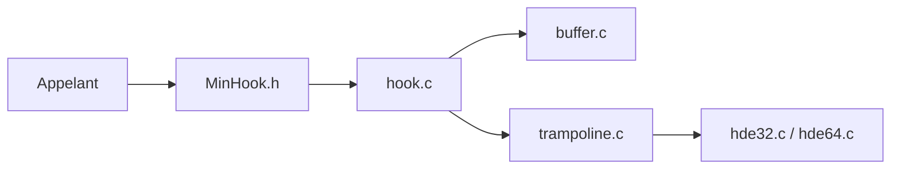

# TsudaKageyu/minhook

> Petite bibliothèque C d'interception d'API Windows x86/x64, pour développeurs système.

## Le problème
Rediriger une fonction Windows vers la sienne demande d'écrire un détour, un trampoline et de relire les instructions déplacées.

## Ce que ça fait vraiment
Crée un hook désactivé sur une fonction cible, puis l'active ; le trampoline renvoyé permet d'appeler l'original. Gère suppression, activation globale et file d'attente pour activer plusieurs hooks d'un coup. En interne : allocation de mémoire exécutable, construction du trampoline, décodeurs d'instructions hde32 et hde64.

## Comment c'est branché


## Essayer
```bash
git clone https://github.com/microsoft/vcpkg
.\vcpkg\bootstrap-vcpkg.bat
.\vcpkg\vcpkg integrate install
.\vcpkg\vcpkg install minhook
```

## Coût et pièges
Gratuit. Windows uniquement. Activer ou désactiver un hook suspend tous les threads : préférer la file d'attente. Licence BSD 2 clauses selon l'historique du README, mais non identifiée par GitHub.

## Ce que ce n'est pas
Pas un outil de reverse prêt à l'emploi ni un framework : une API C minimale. Aucun usage prévu pour l'IA.

## Alternatives
Aucune alternative nommée dans le README.

## Pour toi
À ignorer : hooking Windows bas niveau, hors de tes besoins data/IA/MLOps.

