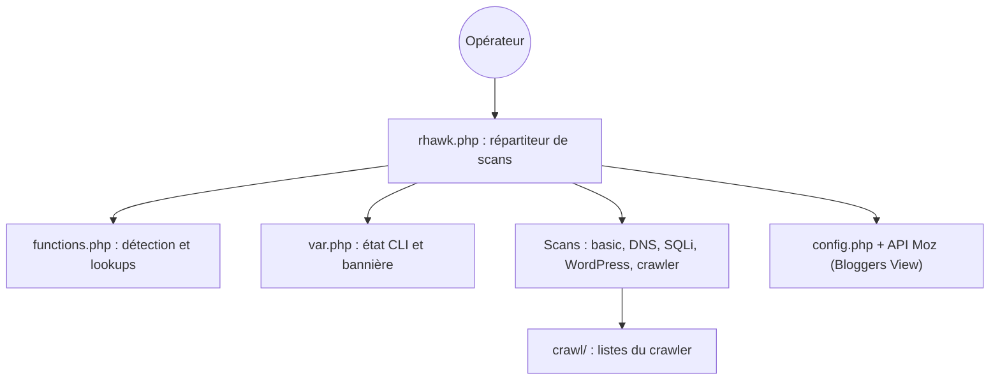

# Tuhinshubhra/RED_HAWK

> Script PHP en ligne de commande qui regroupe collecte d'informations et scans de vulnérabilités sur un site.

## Le problème
Une reconnaissance de site (DNS, whois, sous-domaines, CMS) oblige à enchaîner de nombreux outils séparés.

## Ce que ça fait vraiment
Un menu interactif demande une cible puis lance un scan : titre, IP, serveur web, CMS, Cloudflare, whois, géolocalisation IP, DNS, nmap, sous-domaines, IP inverse, scanner SQLi par erreur, crawler, WordPress, vue « Bloggers » (via l'API Moz). Les résultats s'affichent dans la console.

## Comment c'est branché


## Essayer
```bash
git clone https://github.com/Tuhinshubhra/RED_HAWK
cd RED_HAWK
php rhawk.php
```
Dans l'outil, la commande `fix` installe les modules nécessaires.

## Coût et pièges
Gratuit. La vue Bloggers exige un compte Moz et ses clés dans `config.php`. Le scanner s'arrête après la détection Cloudflare si php-curl et php-xml manquent.

## Ce que ce n'est pas
Pas un scanner maintenu : dernier push en juillet 2024, version 2.0.0 de 2017, des fonctions annoncées en TODO (XSS, LFI). À n'utiliser que sur des cibles autorisées.

## Alternatives
- Aucune alternative nommée dans le README.

## Pour toi
À ignorer : outil ancien et peu maintenu, sans lien avec un travail data ou IA ; mieux vaut un scanner activement suivi.

