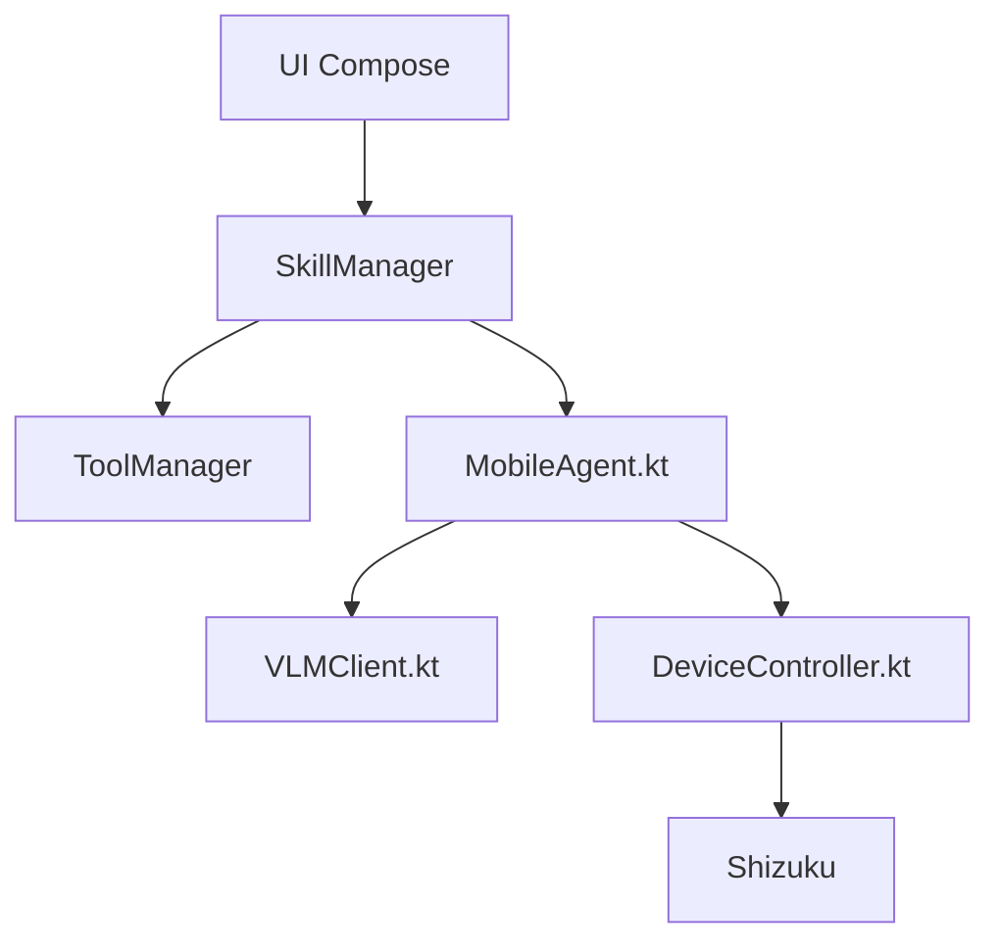

# Turbo1123/roubao

> Native Android application that drives the phone in natural language through a vision model.

## The problem
Mobile automation agents require a computer, an ADB link and a Python environment.

## What it actually does
A Kotlin app that takes screenshots, sends them to a vision-language model, then executes taps, swipes and typing via Shizuku, without a computer. Two layers: Skills (intents) and Tools (atomic actions). The agent core (Manager, Executor, Reflector, Notetaker) is ported from MobileAgent-v3. The API key is encrypted with AES-256-GCM.

## How it is wired


## Trying it
```bash
git clone https://github.com/yourusername/roubao.git
cd roubao
./gradlew assembleDebug
./gradlew installDebug
```
Otherwise, install the APK from the Releases, start Shizuku, then enter the API key in the settings.

## Cost and gotchas
An API key from a model provider (Qwen, OpenAI, etc.) is at your expense. Requires Android 8+, Wi-Fi and Shizuku; the clone address in the README is an example, not the real repository. The cloud crash report is optional and can be disabled.

## What it is not
Not a finished product: several features are still on the roadmap (accessibility, MCP, local model). It stops tasks on payment or password pages, but still acts with elevated privileges. README in Chinese.

## Alternatives
- MobileAgent (Alibaba, Python version): requires a computer, but it is the reference the project derives from.
- Doubao Phone Assistant: closed version of the same concept.

## For you
Worth watching: an interesting idea of a local mobile agent, but experimental, dependent on paid APIs and sensitive system privileges.
