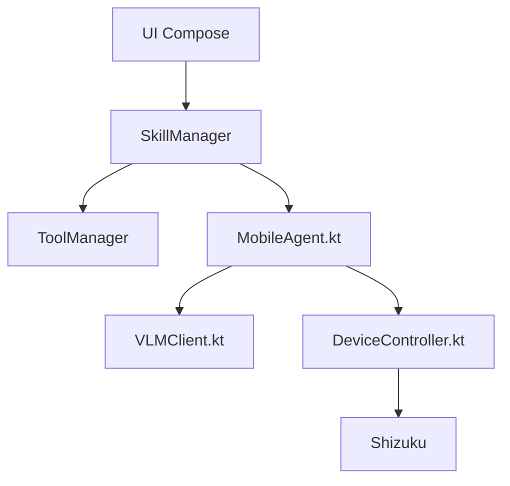

# Turbo1123/roubao

> Application Android native qui pilote le téléphone en langage naturel via un modèle de vision.

## Le problème
Les agents d'automatisation mobile exigent un ordinateur, une liaison ADB et un environnement Python.

## Ce que ça fait vraiment
Une application Kotlin qui prend des captures d'écran, les envoie à un modèle vision-langage, puis exécute taps, glissements et saisies via Shizuku, sans ordinateur. Deux couches : des Skills (intentions) et des Tools (actions atomiques). Le noyau agent (Manager, Executor, Reflector, Notetaker) est porté de MobileAgent-v3. La clé d'API est chiffrée en AES-256-GCM.

## Comment c'est branché


## Essayer
```bash
git clone https://github.com/yourusername/roubao.git
cd roubao
./gradlew assembleDebug
./gradlew installDebug
```
Sinon, installer l'APK depuis les Releases, démarrer Shizuku, puis saisir la clé d'API dans les réglages.

## Coût et pièges
Clé d'API d'un fournisseur de modèle (Qwen, OpenAI, etc.) à ta charge. Exige Android 8+, le Wi-Fi et Shizuku ; l'adresse de clonage du README est un exemple, pas le vrai dépôt. Le rapport de plantage dans le cloud est optionnel et désactivable.

## Ce que ce n'est pas
Pas un produit fini : plusieurs fonctions sont encore en feuille de route (accessibilité, MCP, modèle local). Il arrête les tâches sur les pages de paiement ou de mot de passe, mais agit tout de même avec des droits élevés. README en chinois.

## Alternatives
- MobileAgent (Alibaba, version Python) : nécessite un ordinateur, mais c'est la référence dont le projet est issu.
- Doubao Phone Assistant : version fermée du même concept.

## Pour toi
À surveiller : idée intéressante d'agent mobile local, mais expérimental, dépendant d'API payantes et de droits système sensibles.

