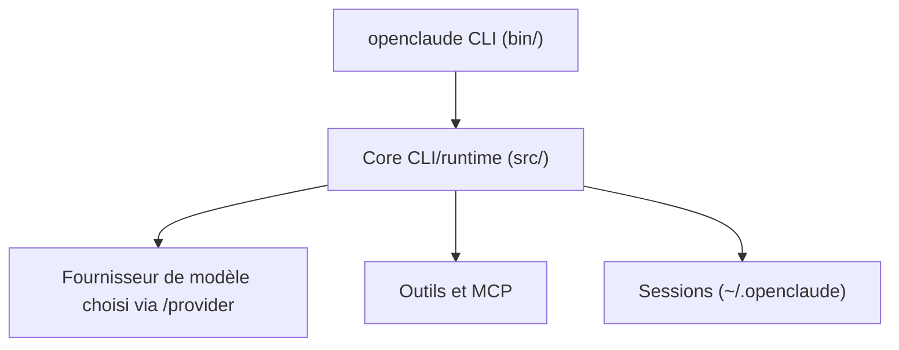

# Twigpine/openclaude

> Terminal coding agent for cloud or local models, published under the name Twigpine, identical to Gitlawb/openclaude.

## The problem
A coding agent tied to a single provider forces you to switch tools in order to switch models.

## What it actually does
Same README as Gitlawb/openclaude: a CLI with tools (bash, files, grep), agents, tasks, MCP, slash commands, provider profiles, resumable or background sessions, repository map, gRPC server and VS Code extension. No architecture diagram is provided for this repository.

## How it is wired

Diagram drawn from the README (`src/`, `bin/`, `~/.openclaude` structure), since no diagram was provided.

## Trying it
```bash
npm install -g @twigpine/openclaude@latest
openclaude
openclaude --bg "fix failing tests"
openclaude ps
```

## Cost and gotchas
Node.js 24.22.1 or later. API keys at your expense except for local Ollama. The default provider asks for a gitlawb.com key. Uninstall the old `@gitlawb/openclaude` package before installing the new one.

## What it is not
Not affiliated with Anthropic. Quality depends on the chosen model. License present but not identified by GitHub: to be checked.

## Alternatives
No alternative named in the README.

## For you
Same verdict as Gitlawb/openclaude, of which it is the twin: useful for testing multi-provider agents, license to be checked before any serious use.
