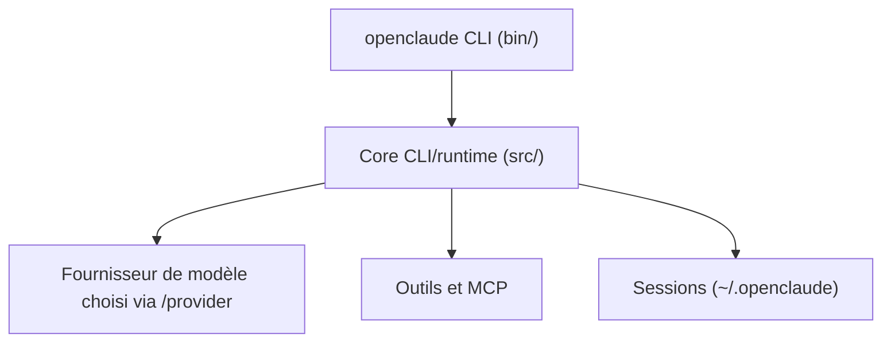

# Twigpine/openclaude

> Agent de code en terminal pour modèles cloud ou locaux, publié sous le nom Twigpine, identique à Gitlawb/openclaude.

## Le problème
Un agent de code lié à un seul fournisseur oblige à changer d'outil pour changer de modèle.

## Ce que ça fait vraiment
Même README que Gitlawb/openclaude : CLI avec outils (bash, fichiers, grep), agents, tâches, MCP, commandes slash, profils de fournisseurs, sessions reprenables ou en arrière-plan, carte du dépôt, serveur gRPC et extension VS Code. Aucun diagramme d'architecture n'est fourni pour ce dépôt.

## Comment c'est branché

Schéma tiré du README (structure `src/`, `bin/`, `~/.openclaude`), faute de diagramme fourni.

## Essayer
```bash
npm install -g @twigpine/openclaude@latest
openclaude
openclaude --bg "fix failing tests"
openclaude ps
```

## Coût et pièges
Node.js 24.22.1 ou plus. Clés d'API à ta charge sauf Ollama local. Le fournisseur par défaut demande une clé gitlawb.com. Désinstaller l'ancien paquet `@gitlawb/openclaude` avant d'installer le nouveau.

## Ce que ce n'est pas
Pas affilié à Anthropic. La qualité dépend du modèle choisi. Licence présente mais non identifiée par GitHub : à vérifier.

## Alternatives
Aucune alternative nommée dans le README.

## Pour toi
Même verdict que Gitlawb/openclaude, dont il est le jumeau : utile pour tester des agents multi-fournisseurs, licence à vérifier avant tout usage sérieux.

