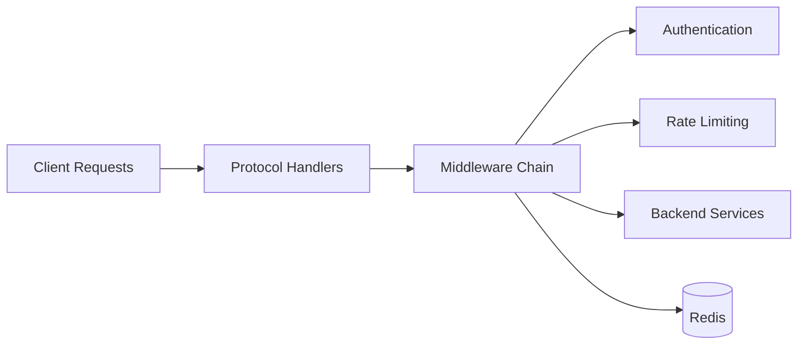

# TykTechnologies/tyk

> Open-source API gateway in Go (REST, GraphQL, gRPC, TCP) with auth, quotas and analytics.

## The problem
Exposing APIs requires auth, rate limiting, versioning and logging, which you do not want to recode in every service.

## What it actually does
Gateway with a middleware chain: OIDC, JWT, Basic, client certificates, rate limiting and quotas.
Import of OpenAPI/Swagger specs, request/response transformation, CORS, event webhooks.
Plugins in Python, JavaScript, Go or any gRPC language; hot reload; Redis as storage.
Kubernetes operator and companion tools (Pump, Identity Broker, Sync).

## How it is wired
The provided graph has no readable component; diagram based on the explanation:


## Trying it
```bash
git clone https://github.com/TykTechnologies/tyk-gateway-docker
cd tyk-gateway-docker
docker-compose up
curl localhost:8080/hello
```

## Cost and gotchas
Core under MPL v2.0, `ee` folder under a commercial license; GitHub does not recognise the license. Redis required, even for tests.

## What it is not
Not the full management platform: Dashboard, developer portal and control plane are in the paid Self Managed or Cloud offering.

## Alternatives
None named in the README.

## For you
Ignore: useful for a platform team publishing APIs, not for serving or tracking models; too heavy for exposing a simple inference endpoint.
