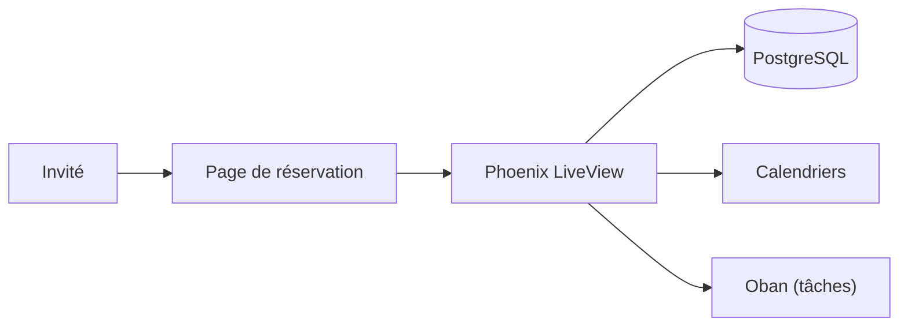

# Tymeslot/tymeslot

> Self-hostable appointment booking application, an alternative to Calendly and Cal.com, for freelancers and small teams.

## The problem
Online booking tools lock features behind subscriptions and host your data.

## What it actually does
Booking pages with four themes, appointment types, availability, calendar sync (Google, Outlook, iCloud, CalDAV), automatic video rooms, emails with an .ics invitation, signed webhooks and optional Stripe payments. Stack: Elixir, Phoenix LiveView, PostgreSQL, Oban. A paid cloud offering exists (Pro at 9 euros per month).

## How it is wired
Simplified diagram based on the sheet, no diagram provided.


## Trying it
```bash
docker run --name tymeslot -p 4000:4000 \
  -e SECRET_KEY_BASE="$(openssl rand -base64 64 | tr -d '\n')" \
  -e PHX_HOST=localhost \
  -v tymeslot_data:/app/data -v tymeslot_pg:/var/lib/postgresql/data \
  luka1thb/tymeslot:latest
```

## Cost and gotchas
Free when self-hosted; SMTP, TLS and backups are your responsibility. AGPL-3.0 license: sharing obligations if you modify it and expose the service.

## What it is not
It is not a data or AI tool. The README names neither the author nor the contributors; governance is inferred from the repository of an individual account.

## Alternatives
Cal.com and Calendly are cited as the products being replaced, with no detailed alternative link.

## For you
Ignore: a scheduling tool unrelated to your field; only useful if you are looking for a self-hosted Calendly.
