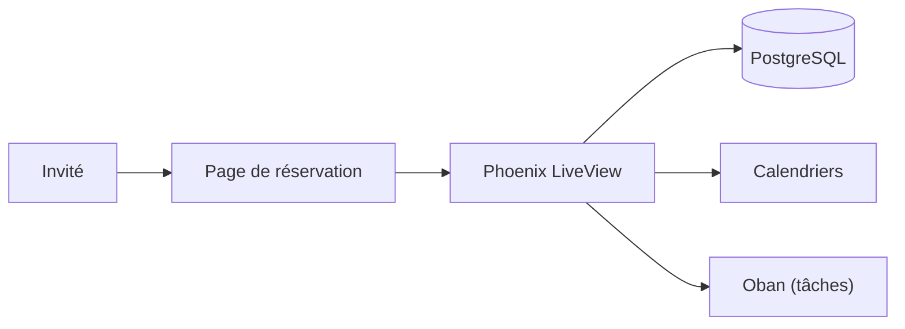

# Tymeslot/tymeslot

> Application de prise de rendez-vous auto-hébergeable, alternative à Calendly et Cal.com, pour indépendants et petites équipes.

## Le problème
Les outils de réservation en ligne verrouillent des fonctions derrière des abonnements et hébergent tes données.

## Ce que ça fait vraiment
Pages de réservation avec quatre thèmes, types de rendez-vous, disponibilités, synchronisation de calendriers (Google, Outlook, iCloud, CalDAV), salles de visio automatiques, e-mails avec invitation .ics, webhooks signés et paiements Stripe optionnels. Stack Elixir, Phoenix LiveView, PostgreSQL, Oban. Une offre cloud payante existe (Pro à 9 euros par mois).

## Comment c'est branché
Schéma simplifié d'après la fiche, sans diagramme fourni.


## Essayer
```bash
docker run --name tymeslot -p 4000:4000 \
  -e SECRET_KEY_BASE="$(openssl rand -base64 64 | tr -d '\n')" \
  -e PHX_HOST=localhost \
  -v tymeslot_data:/app/data -v tymeslot_pg:/var/lib/postgresql/data \
  luka1thb/tymeslot:latest
```

## Coût et pièges
Gratuit en auto-hébergement ; SMTP, TLS et sauvegardes sont à ta charge. Licence AGPL-3.0 : obligations de partage si tu modifies et exposes le service.

## Ce que ce n'est pas
Ce n'est pas un outil de data ou d'IA. Le README ne nomme pas l'auteur ni les contributeurs ; la gouvernance est déduite du dépôt d'un compte individuel.

## Alternatives
Cal.com et Calendly sont cités comme les produits remplacés, sans lien d'alternative détaillé.

## Pour toi
À ignorer : outil de planification sans lien avec ton métier ; utile seulement si tu cherches un Calendly auto-hébergé.

