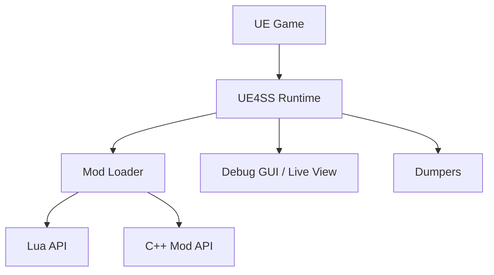

# UE4SS-RE/RE-UE4SS

> Lua and C++ scripting system for modding Unreal Engine 4/5 games, with a live property editor.

## The problem
Modding an Unreal game without access to the sources forces manual reverse engineering.

## What it actually does
Injected into the game (proxy DLL), it reads the settings, discovers mods and hooks Unreal objects. Lua and C++ APIs, loading of Blueprint mods without modifying the game files, live property viewer/editor, dumpers (UHT headers, C++ headers, `.usmap` files, `.umap` files). Targets Unreal 4.7 to 5.8; AOB signatures may need a manual update.

## How it is wired


## Trying it
```bash
git submodule update --init --recursive
cmake -B build_cmake_Game__Shipping__Win64 -G Ninja -DCMAKE_BUILD_TYPE=Game__Shipping__Win64
cmake --build build_cmake_Game__Shipping__Win64
```

## Cost and gotchas
Free. Native Windows build (MSVC C++23, Rust ≥ 1.73, CMake ≥ 3.22); a GitHub account linked to Epic Games is needed for one submodule. Linux cross-compilation is possible with xwin.

## What it is not
Not a plug-and-play solution: the goal is a base that works on most games, not all of them.

## Alternatives
No alternative named in the README.

## For you
Ignore: game modding, unrelated to data/AI/MLOps.
