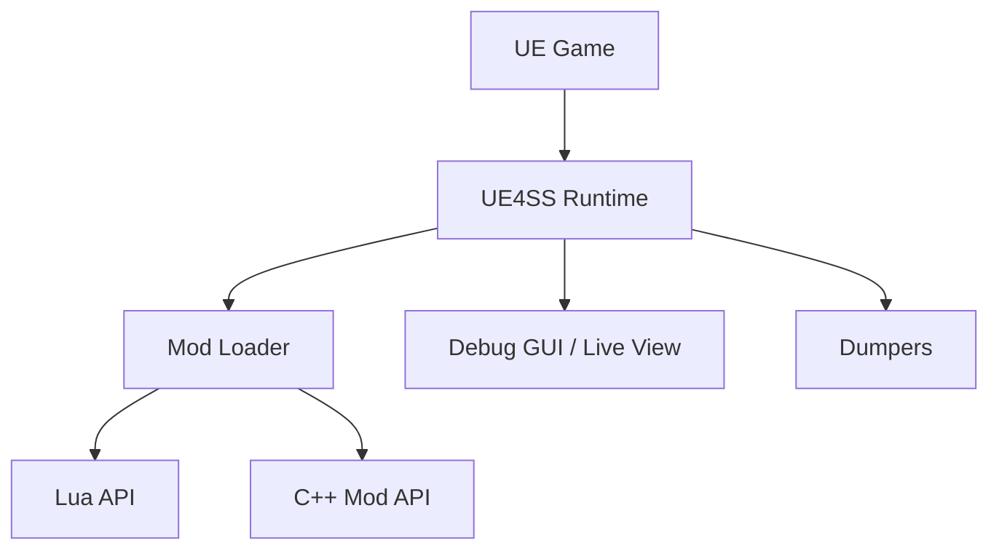

# UE4SS-RE/RE-UE4SS

> Système de scripts Lua et C++ pour modder les jeux Unreal Engine 4/5, avec éditeur de propriétés en direct.

## Le problème
Modder un jeu Unreal sans accès aux sources oblige à rétro-ingénierie manuelle.

## Ce que ça fait vraiment
Injecté dans le jeu (DLL proxy), il lit les réglages, découvre les mods et accroche les objets Unreal. API Lua et C++, chargement de mods Blueprint sans modifier les fichiers du jeu, visualiseur/éditeur de propriétés en direct, dumpers (en-têtes UHT, en-têtes C++, fichiers `.usmap`, `.umap`). Vise Unreal 4.7 à 5.8 ; les signatures AOB peuvent demander une mise à jour manuelle.

## Comment c'est branché


## Essayer
```bash
git submodule update --init --recursive
cmake -B build_cmake_Game__Shipping__Win64 -G Ninja -DCMAKE_BUILD_TYPE=Game__Shipping__Win64
cmake --build build_cmake_Game__Shipping__Win64
```

## Coût et pièges
Gratuit. Build natif Windows (MSVC C++23, Rust ≥ 1.73, CMake ≥ 3.22) ; compte GitHub lié à Epic Games pour un sous-module. Compilation croisée Linux possible avec xwin.

## Ce que ce n'est pas
Pas une solution plug-and-play : l'objectif est une base qui marche sur la plupart des jeux, pas tous.

## Alternatives
Aucune alternative nommée dans le README.

## Pour toi
À ignorer : modding de jeux, sans lien avec data/IA/MLOps.

