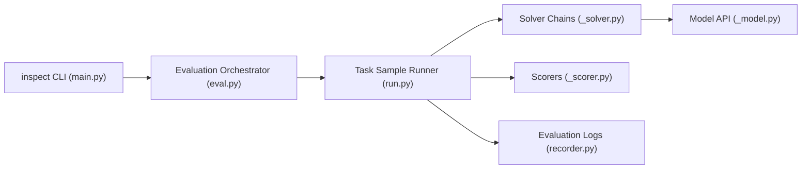

# UKGovernmentBEIS/inspect_ai

> Python LLM evaluation framework created by the UK AI Security Institute, for AI engineers.

## The problem
Comparing models and agents reproducibly: prompts, tools, multi-turn dialogues, scoring, logs.

## What it actually does
A task combines a dataset, solver chains, model calls, tools and scorers. Adapters for OpenAI, Anthropic, Google, Bedrock, Azure, Hugging Face, local models. Agents (ReAct, sub-agents), MCP tools, Docker sandboxes, typed logs, resumption after interruption, a web viewer. More than 200 ready-to-use evaluations.

## How it is wired


## Trying it
The README only gives development commands:
```bash
git clone https://github.com/UKGovernmentBEIS/inspect_ai.git
cd inspect_ai
pip install -e ".[dev]"
make check
make test
```

## Cost and gotchas
Evaluations call paid models: the bill is yours. Sandboxes require Docker. Usage documentation is on an external site, not reproduced in the README.

## What it is not
Not a fixed set of benchmarks: it is the engine. The README does not present end-user installation.

## Alternatives
No alternative named in the README.

## For you
Adopt: an evaluation framework backed by an institution, active (recent push), directly useful for measuring your models and agents.
