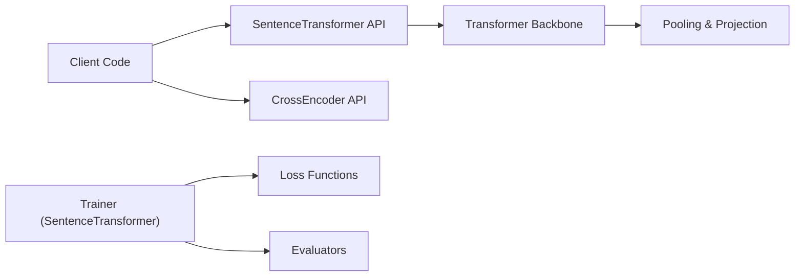

# UKPLab/sentence-transformers

> Python library for computing embeddings, rerankers and sparse encoders, and for fine-tuning them.

## The problem
Comparing texts or doing semantic search requires quality embeddings and a simple way to train them on your own data.

## What it actually does
Provides four model families: SentenceTransformer (dense embeddings), CrossEncoder (rerankers), SparseEncoder (SPLADE) and MultiVectorEncoder (ColBERT). More than 15,000 pretrained models are available on Hugging Face. A trainer integrates more than 20 loss functions for embeddings, evaluations, and applications for semantic search, clustering, paraphrase mining. Maintained by Tom Aarsen (Hugging Face).

## How it is wired


## Trying it
```bash
pip install -U sentence-transformers
python -c "from sentence_transformers import SentenceTransformer; m=SentenceTransformer('sentence-transformers/all-MiniLM-L6-v2'); print(m.encode(['The weather is lovely today.']).shape)"
python -m pip install -e ".[dev]"
pytest
```

## Cost and gotchas
Free; Python 3.10+, PyTorch 2.2+ and transformers v5.0+ recommended. Models are downloaded from Hugging Face. The catalogue does not give the license; the README points to a LICENSE file in the huggingface repository.

## What it is not
Not a vector store: it computes embeddings, it does not store them. The README states that the original repository is experimental software published as a paper reference.

## Alternatives
No alternative named in the README.

## For you
Adopt: a core building block for semantic search and reranking, with a wide choice of models; check the exact license in the repository.
