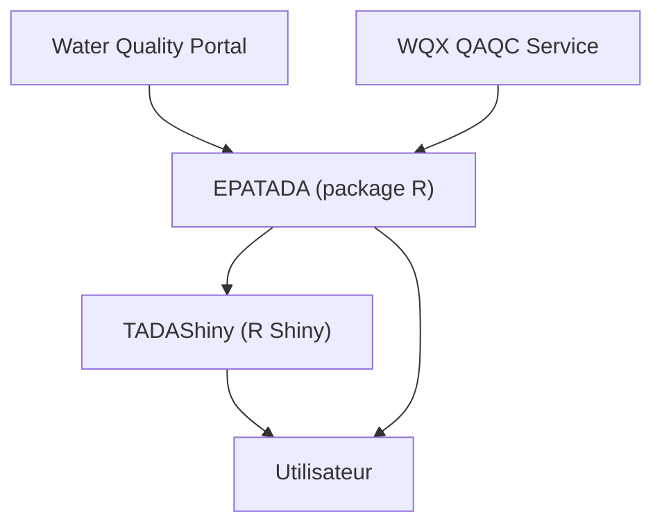

# USEPA/EPATADA

> R package from the US EPA for compiling and checking WQP water quality data.

## The problem
Water Quality Portal data comes from more than a thousand partners and is heavy to assemble and check by hand.

## What it actually does
An R package that helps compile and assess WQP data collected at monitoring sites. It also serves as a building block for the TADAShiny R Shiny application, which exists as a web version or launched from RStudio. It relies on the WQX QAQC service.

## How it is wired
Simplified diagram based on the sheet, no diagram provided.



## Trying it
```bash
# Dans R / RStudio
install.packages("remotes")
remotes::install_github("USEPA/EPATADA", ref = "develop", dependencies = TRUE, force = TRUE)
library(EPATADA)
```

## Cost and gotchas
Free, but you need to install R and RStudio. The README recommends updating the package and its dependencies at each use, because development is active. The web version of the application lags behind the local version.

## What it is not
It is not a general-purpose data science tool: it is tailored to WQP data. The README documents no analysis command, and points to a reference site and articles instead. The web application may time out on large datasets.

## Alternatives
- TADAShiny: the Shiny interface of the same project, for those who do not want to write R.

## For you
Ignore unless you work on US hydrological data: the tool is highly specialized and written in R, far from a daily data / AI / MLOps routine.
