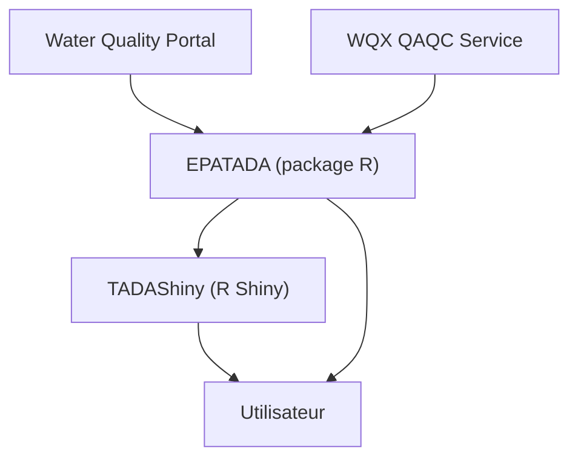

# USEPA/EPATADA

> Package R de l'agence américaine EPA pour compiler et contrôler les données de qualité de l'eau du WQP.

## Le problème
Les données du Water Quality Portal viennent de plus de mille partenaires et sont lourdes à assembler et à contrôler à la main.

## Ce que ça fait vraiment
Un package R qui aide à compiler et évaluer les données du WQP collectées sur des sites de surveillance. Il sert aussi de brique à l'application R Shiny TADAShiny, qui existe en version web ou lancée depuis RStudio. Il s'appuie sur le service WQX QAQC.

## Comment c'est branché
Schéma simplifié d'après la fiche, sans diagramme fourni.



## Essayer
```bash
# Dans R / RStudio
install.packages("remotes")
remotes::install_github("USEPA/EPATADA", ref = "develop", dependencies = TRUE, force = TRUE)
library(EPATADA)
```

## Coût et pièges
Gratuit, mais il faut installer R et RStudio. Le README recommande de mettre à jour le package et ses dépendances à chaque usage, car le développement est actif. La version web de l'application est en retard sur la version locale.

## Ce que ce n'est pas
Ce n'est pas un outil généraliste de data science : il est taillé pour les données du WQP. Le README ne documente pas de commande d'analyse, il renvoie à un site de référence et à des articles. L'application web peut expirer sur de gros jeux de données.

## Alternatives
- TADAShiny : l'interface Shiny du même projet, pour qui ne veut pas écrire de R.

## Pour toi
À ignorer sauf si tu travailles sur des données hydrologiques américaines : l'outil est très spécialisé et écrit en R, loin d'un quotidien data / IA / MLOps.

