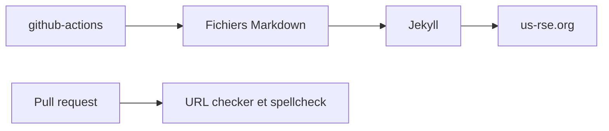

# USRSE/usrse.github.io

> Jekyll source of the official website of the US Research Software Engineer association.

## The problem
A volunteer community must maintain a website, its events and job postings, without friction.

## What it actually does
Jekyll site hosted on GitHub. Content is in Markdown (`_events`, `_pages`, `wg`), images in `/assets/img`. Automatic commits (github-actions) update, for example, the jobs board. PRs go through a URL checker and a spell checker.

## How it is wired
Simplified diagram based on the sheet, no diagram provided.



## Trying it
```bash
git fetch upstream main
git diff main upstream/main
git reset --hard upstream/main
git push origin main --force
```

## Cost and gotchas
Free. GitHub account required; members have access to Slack. Bot commits complicate syncing a fork. License not declared.

## What it is not
Not a reusable tool: it is the code of one specific community site.

## Alternatives
No alternative named in the README.

## For you
Ignore: source of an association's site, unrelated to data or AI.
