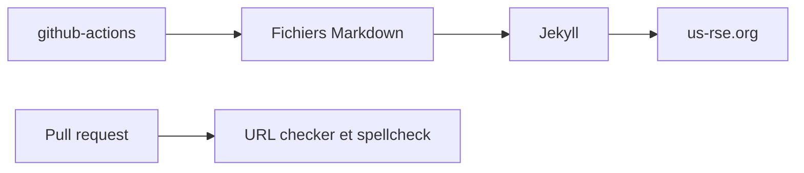

# USRSE/usrse.github.io

> Source Jekyll du site officiel de l'association américaine des ingénieurs logiciel de recherche.

## Le problème
Une communauté bénévole doit maintenir un site, ses événements et offres d'emploi, sans friction.

## Ce que ça fait vraiment
Site Jekyll hébergé sur GitHub. Le contenu est en Markdown (`_events`, `_pages`, `wg`), les images dans `/assets/img`. Des commits automatiques (github-actions) mettent à jour par exemple le tableau d'offres. Les PR passent un vérificateur d'URL et un correcteur orthographique.

## Comment c'est branché
Schéma simplifié d'après la fiche, sans diagramme fourni.



## Essayer
```bash
git fetch upstream main
git diff main upstream/main
git reset --hard upstream/main
git push origin main --force
```

## Coût et pièges
Gratuit. Compte GitHub requis ; les membres ont accès à Slack. Les commits de bots compliquent la synchronisation d'un fork. Licence non déclarée.

## Ce que ce n'est pas
Pas un outil réutilisable : c'est le code d'un site communautaire précis.

## Alternatives
Aucune alternative nommée dans le README.

## Pour toi
À ignorer : source d'un site associatif, sans rapport avec la data ou l'IA.

