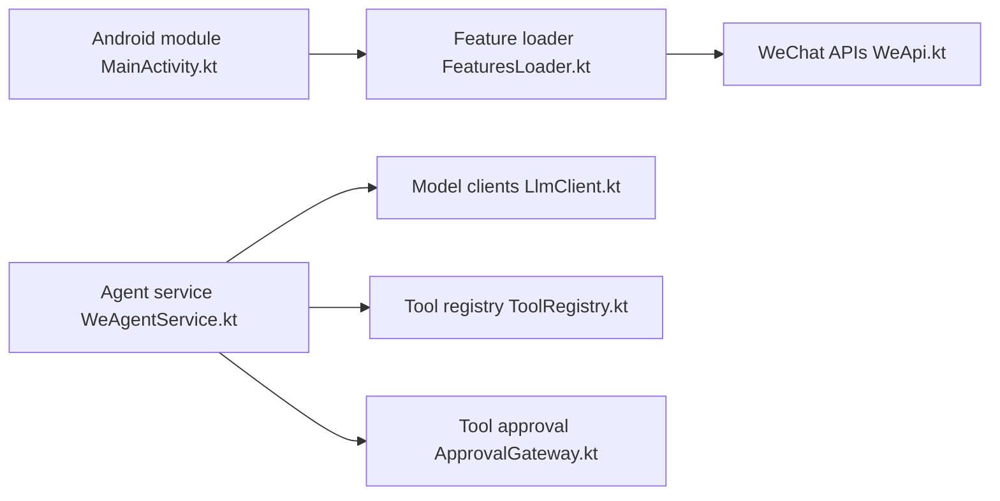

# Ujhhgtg/WeKit

> Android module that adds features to WeChat via Xposed or Zygisk, with a built-in conversational agent.

## The problem
WeChat does not allow its behavior to be extended; existing modules are scattered.

## What it actually does
Very short README: it points to external documentation. From the code architecture: a feature loader, a WeChat API, a Java scripting engine, extension packs, and an agent service (turn loop, model clients, tool registry, tool approval, triggers, Linux terminal, database).

## How it is wired

## Trying it
No command documented in the README (external installation guide).

## Cost and gotchas
Hooking a third-party app: risk of a WeChat account ban (not documented in the README). Depends on Xposed or Zygisk, hence a rooted device.

## What it is not
Not an official module: the README admits reusing code from neighboring projects. Documentation is in Chinese.

## Alternatives
WAuxiliary, NewMiko and QAuxiliary (credited projects).

## For you
Ignore: injection into WeChat unrelated to data or AI, with an account risk.
