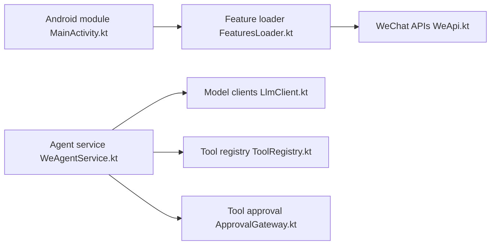

# Ujhhgtg/WeKit

> Module Android qui ajoute des fonctions à WeChat via Xposed ou Zygisk, avec un agent conversationnel intégré.

## Le problème
WeChat ne permet pas d'étendre son comportement ; les modules existants sont dispersés.

## Ce que ça fait vraiment
README très court : renvoie à une documentation externe. D'après l'architecture du code : chargeur de fonctionnalités, API WeChat, moteur de script Java, packs d'extension, et un service d'agent (boucle de tours, clients de modèles, registre d'outils, approbation d'outils, déclencheurs, terminal Linux, base de données).

## Comment c'est branché

## Essayer
Aucune commande documentée dans le README (guide d'installation externe).

## Coût et pièges
Hook d'une application tierce : risque de blocage de compte WeChat (non documenté dans le README). Dépendance à Xposed ou Zygisk, donc appareil rooté.

## Ce que ce n'est pas
Pas un module officiel : le README admet reprendre du code de projets voisins. Documentation en chinois.

## Alternatives
WAuxiliary, NewMiko et QAuxiliary (projets crédités).

## Pour toi
À ignorer : injection dans WeChat sans rapport avec la data ou l'IA, avec un risque de compte.

