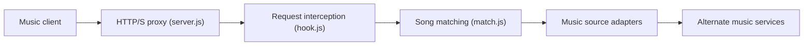

# UnblockNeteaseMusic/server

> Node.js proxy that replaces greyed-out NetEase Cloud Music tracks with alternative sources.

## The problem
Some tracks in the NetEase client are unavailable (rights or region restrictions).

## What it actually does
HTTP/HTTPS proxy (with PAC) that intercepts the NetEase client's requests, looks the track up at other providers (QQ, Kugou, Kuwo, Migu, JOOX, YouTube via yt-dlp, Bilibili…) and returns the replacement URL. Options: real IP, upstream proxy, strict mode, relay in China, local VIP, ad blocking. Also usable as a library.

## How it is wired


## Trying it
```bash
npm install @unblockneteasemusic/server
npx -p @unblockneteasemusic/server unblockneteasemusic
node app.js -o bilibili ytdlp
```

## Cost and gotchas
Free; cookies from some providers are required. Self-signed certificate for recent clients. Do not expose the proxy without strict mode.

## What it is not
No online demo: the README advises against third-party public proxies. It works around rights restrictions; legal status is not addressed.

## Alternatives
Several projects credited in the acknowledgements, including Unblock163MusicClient.

## For you
Ignore: unrelated to data/AI, and it touches rights restrictions.
